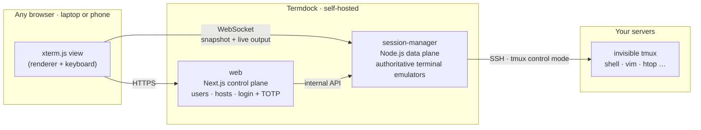

<div align="center">

# Termdock

**Your terminals, docked. Close the browser, come back anywhere, and pick up exactly where you left off.**

A self-hosted, persistent terminal-session runtime for SSH, accessible from the web.

[](#status-and-roadmap)
[](https://www.typescriptlang.org/)
[](https://nodejs.org/)
[](https://nextjs.org/)
[](https://react.dev/)
[](https://xtermjs.org/)
[](https://github.com/tmux/tmux)
[](https://orm.drizzle.team/)
[](https://docs.docker.com/compose/)
[](https://pnpm.io/)
[](https://vitest.dev/)
[](https://biomejs.dev/)

</div>

---

## The idea

In most web SSH tools, the browser tab **is** the session: close the laptop or lose Wi-Fi, and the connection dies with it. Termdock flips that around.

> **The browser lifecycle is not the terminal lifecycle.**

Termdock runs on a server you control and holds your SSH sessions open **on the server side**, indefinitely, until you decide to end them. Browsers only *attach* and *detach*. When you come back, from the same laptop, another computer or your phone, every terminal is exactly as you left it. You get the same screen, cursor, colors and scrollback, with `vim` or `htop` still running.

Think of it as tmux, but the "client" is any browser, the sessions live in a service rather than in a terminal window, and you never have to type `tmux attach` again.

## Why it is different

| What happens… | Typical web SSH | Termdock |
|---|---|---|
| You close the browser tab | The SSH session dies | Nothing; the session keeps running |
| You reopen it on another device | You start over | Same screen, instantly, including full-screen apps |
| Your Wi-Fi drops for a minute | The session is lost | It reconnects behind the scenes; the shell never noticed |
| The Termdock service restarts | — | Protected sessions come back as they were ("Restoring…") |
| Two devices open the same session | Usually not supported | Both attach; the one you are typing on sets the size |

## How it works



Three ideas carry the design:

1. **A terminal emulator lives on the server.** For every session, `session-manager` keeps an authoritative [`@xterm/headless`](https://github.com/xtermjs/xterm.js) instance fed with the raw SSH output. When a browser attaches, it receives a serialized **snapshot** of that state followed by the live byte stream, so it renders an exact copy, alternate screen and terminal modes included.
2. **tmux protects sessions, and you never see it.** Every SSH session automatically runs inside a dedicated remote tmux server, driven through tmux's **control mode** (the same technique as iTerm2's tmux integration). tmux draws nothing: no status bar, no prefix key, and scrollback stays normal. If the network drops or Termdock restarts, it reattaches and rebuilds the screen and history from tmux. Hosts without tmux still work; the session is simply marked as *not protected*.
3. **Sessions are owned by the service, not the browser.** The web app (control plane) manages users, hosts, credentials and layout. The session-manager (data plane) owns connections, emulators and reconnection. Deploying a new web version never drops a terminal.

## Features (v0.1 goals)

- 🖥️ **Persistent SSH sessions** that survive closed tabs, flaky networks and service restarts.
- 🛡️ **Automatic, invisible tmux protection**, with auto-detection and graceful fallback.
- 🪟 **Workspace** with a session sidebar, tabs and split panes. Your layout is saved on the server and restored in any browser.
- 📱 **Usable from a phone**, with a responsive layout and an extra-key bar (Esc, Ctrl, Tab, arrows…).
- 👥 **Multi-user with strict isolation**: each user sees only their own hosts, credentials and sessions.
- 🔐 **Built like a bastion**:
  - Credentials are encrypted with a key that only the data plane holds.
  - Host keys are verified with explicit trust on first use and a hard fail on mismatch.
  - Login uses username/password plus optional TOTP, with rate limits.
  - Audit logs record session and security events.
- 🔑 **SSH authentication** with private keys (with passphrase), passwords, and keyboard-interactive prompts (OTP/2FA) relayed to your browser.
- 🏠 **Local mode**, for running Termdock on the target machine itself.
- 🌍 **English and Brazilian Portuguese** UI.
- 🐳 **One-command deployment** with Docker Compose and Caddy (automatic HTTPS).

## Status and roadmap

> [!WARNING]
> Termdock is in **early development** and not usable yet. The core runtime is being built and verified piece by piece; the UI comes next.

| Phase | Scope | Status |
|---|---|---|
| 0 | Foundations, canonical contracts, de-risking spikes: emulator fidelity, tmux control protocol, state rebuild under load, flow control, lifecycle (all GO, see ADRs) | ✅ |
| 1 | Data plane core: session runtime, WebSocket protocol, raw SSH driver, SQLite persistence, credential vault, internal API, daemon boot, dev CLI | ✅ |
| 2 | Web control plane: login + TOTP, admin, hosts/credentials/profiles, i18n (auth core in progress) | 🚧 |
| 3 | tmux control-mode protection end to end (driver done; daemon integration in progress) | 🚧 |
| 4 | Resilience: reconnect, host-key trust UX, keyboard-interactive flows | ⏳ |
| 5 | Workspace UI: sidebar, tabs, splits, mobile key bar | ⏳ |
| 6 | Local modes (Docker host preset, direct mode) | ⏳ |
| 7 | Compatibility fallback for old tmux versions | ⏳ |
| 8 | Hardening, security review, docs, release v0.1.0 | ⏳ |

The full plan, with architecture, protocol, data model, security model and per-phase exit criteria, lives in [`docs/implementation-plan.md`](docs/implementation-plan.md). Spike results are recorded as ADRs in [`docs/adr/`](docs/adr/).

## Tech stack

| Layer | Choice |
|---|---|
| Language | TypeScript (strict) everywhere, ESM, Node.js 24 LTS (runs `.ts` directly) |
| Web / control plane | Next.js 16 (App Router), React 19, Tailwind CSS 4, Better Auth, next-intl |
| Data plane | Node.js daemon with `ssh2`, `@xterm/headless` + `@xterm/addon-serialize`, `ws` |
| Persistence | SQLite (WAL) through Drizzle ORM, ready for PostgreSQL later |
| Protection | tmux ≥ 3.2 in control mode on the remote host |
| Deployment | Docker Compose + Caddy |
| Tooling | pnpm workspaces, Biome, Vitest, dockerized sshd test matrix |

## Getting started (development)

You need **Node.js 24**, **pnpm 11** and **Docker** (for the test SSH servers).

```bash
pnpm install                                   # dependency build scripts are blocked by policy
docker compose -f test/sshd/compose.yaml up -d # test sshd containers: no tmux, tmux 3.2a, 3.4, newest
pnpm check                                     # typecheck + lint + fast tests (T0)
pnpm test:area tmux                            # integration tests for one area (terminal | ssh | tmux)
```

The test containers listen on `127.0.0.1:2201–2204` and use **test-only** keys from [`test/sshd/keys/`](test/sshd/keys/). Never reuse them anywhere else.

### Repository layout

```text
apps/
  session-manager/   Node.js daemon: transports, drivers (raw PTY, tmux control mode),
                     server-side emulators, session runtime, WebSocket server
  web/               Next.js control plane (UI, auth, admin)
packages/
  protocol/          WebSocket protocol v1, internal API schemas, WS tickets
  db/                Drizzle schema and migrations (SQLite)
  terminal-config/   xterm options shared by server and browser, query silencer, mode tracker
  shared/            ids, error codes
test/sshd/           SSH server images used by the integration tests
docs/                implementation plan and architecture decision records
```

## Security

Termdock is designed to be deployed as a **privileged bastion**: whoever controls it can reach every registered server. The design reflects that:

- SSH secrets are encrypted at rest (AES-256-GCM) and can only be decrypted by the data plane.
- There is no `StrictHostKeyChecking=no` anywhere.
- WebSockets authenticate with short-lived, single-use tickets.
- Every request is scoped to its owner.
- Terminal contents are never logged.

The threat model and controls are described in the [implementation plan](docs/implementation-plan.md#10-security). Please do not use Termdock in production before the first release and its security review.

## License

The license has not been chosen yet. It will be decided before the project is opened to the public.

---

<div align="center">
<sub>Termdock — a terminal that stays docked while you are away.</sub>
</div>
