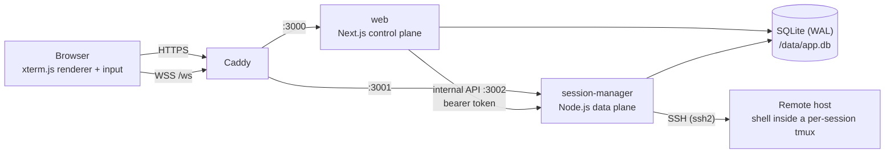
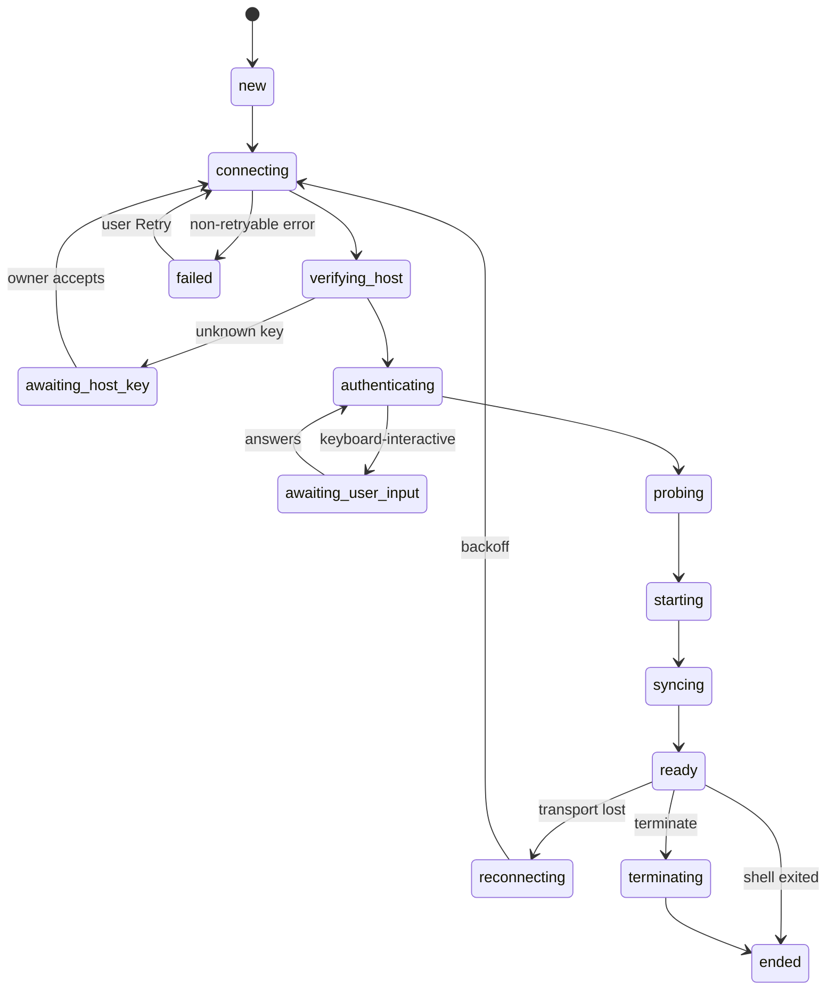

# Architecture overview

A map of Termdock for contributors. The full design is in the
[implementation plan](implementation-plan.md) (§4 architecture, §5 runtime, §6 tmux, §7 protocol,
§9 data model); spike outcomes are recorded as [ADRs](adr/README.md). The security side is in
[security.md](security.md), and every setting in the
[configuration reference](guides/configuration.md).

## Components



| Component | Responsibilities |
|---|---|
| **Caddy** | TLS, the only public listener. `/ws` → session-manager, everything else → web. |
| **web** (`apps/web`) | UI, sign-in and TOTP (Better Auth), users and admin, servers, workspace layout, preferences, audit view. Issues WebSocket tickets. Asks the daemon to create, terminate, rename, retry or reopen sessions and to manage credentials and host keys. |
| **session-manager** (`apps/session-manager`) | Owns every session: SSH connections, drivers, the authoritative server-side emulators, reconnection and restore. Serves the browsers' WebSockets and web's internal API. The only holder of the vault master key. |
| **SQLite** | One database file shared by both processes. session-manager applies the migrations at boot. |

The rule behind the split: **the browser lifecycle is not the terminal lifecycle.** Sessions
belong to session-manager, so restarting web never touches a terminal, and browsers only attach
and detach. WebSockets terminate on session-manager, never on Next.js.

## Inside session-manager

```text
SessionRegistry            every runtime of the process; boot restore; idle eviction
├── RemoteSweeper          after a session is ready: leftover tmux servers on its server
└── SessionRuntime         one per session (the SessionHost boundary): state machine, seq,
    │                      size policy, attachments, snapshots
    ├── Emulator           @xterm/headless + serialize addon + mode tracker (the authority)
    └── Driver             RawPtyDriver | TmuxControlDriver
        └── Transport      SshTransport (ssh2): connect, host-key check, auth, exec, PTY
```

- `main.ts` boots: parse the environment → take the data directory lock
  (`session-manager.lock`) → open and migrate the DB → `installation_id` → load and check the
  master key → read the secret files → WebSocket server and boot restore → internal API → event
  retention job. SIGTERM/SIGINT start a graceful shutdown with a 25 s budget.
- The canonical interfaces (`Transport`, `Driver`, `Emulator`, `SessionHost`, …) are in
  `src/core/types.ts`. Drivers never write to the emulator: they hand output to the runtime,
  which assigns sequence numbers, feeds the emulator and fans out to attachments.
- `src/store/` holds the SQLite access: a batched writer for session events and state updates,
  the session, host-key, settings and audit stores, the event retention purge and the data
  directory lock. `src/vault/` encrypts credentials.

## Session lifecycle



Internal states are persisted in `sessions.state`. The UI only shows the user-facing status
from `toSessionStatus(state, wasReady)` in `packages/protocol`: **Connecting…** or, once the
session has been ready before, **Restoring…** (all the setup states), **Connected**,
**Action required** (`awaiting_host_key`, `awaiting_user_input`), **Reconnecting…**,
**Disconnected** (`failed`) and **Ended** ([plan §5.6](implementation-plan.md#56-state-machine)).

- **Desired state.** `desired_state = running` keeps a session alive: reconnects retry forever
  with backoff (1 s doubling to 60 s, ±20% jitter). Terminate, or reaching `ended`, sets it to
  `terminated`; reopen sets it back. Non-retryable failures (auth rejected, host-key mismatch,
  target not allowed, bad launch parameters, …) park in `failed` until the user retries.
- **Deleted server.** A session whose server was deleted never connects again: Retry and Reopen
  answer `404` ("server was deleted"), and any other attempt (boot restore, a reconnect) parks
  it in `failed` with `NOT_FOUND` before a connection is opened.
- **Boot restore.** Every session meant to run, except parked failures, is restarted with at
  most 4 connects at once, spaced per address. `restore_started`, `restored` and `restore_failed`
  are recorded as session events.
- **Graceful shutdown.** Stop accepting attachments, send `server.shutting_down` (browsers show
  "Restoring…"), detach tmux control clients cleanly so the remote tmux keeps running, flush the
  batched writer, and log how many tmux-protected sessions keep running on their servers.
- **Terminate while not connected.** A protected session's tmux still runs on its server: the
  daemon connects just to end it (same host-key and credential rules, never prompting). If it
  cannot, the session ends anyway and the next connection to that server as that user ends the
  leftover; tmux servers no session record knows are listed on the server page with End and
  Adopt ([plan §6.12](implementation-plan.md#612-remote-leftovers-d-30)).
- A runtime whose session is not meant to run and has no viewer is freed after 60 s.

## Protection modes and restore

On every connect a capability probe runs over one SSH exec channel and selects the session's
protection ([plan §5.11](implementation-plan.md#511-capability-probe)):

| Profile `protection_mode` | Probe result | Protection |
|---|---|---|
| `auto` (default) | tmux ≥ 3.2 and a UTF-8 locale | `tmux-control` |
| `auto` | no tmux, tmux < 3.2, or no UTF-8 locale | `none`, with a notice |
| `off` | any | `none` |

The `tmux-normal` fallback for older tmux is planned (Phase 7); until then those hosts run
unprotected. Protection is fixed at creation; if a later reconnect cannot use tmux, the session
degrades to `none` with a banner and an event, never silently.

**`tmux-control`** ([ADR-0002](adr/0002-tmux-control-protocol.md),
[ADR-0003](adr/0003-tmux-control-driver.md)). The driver runs
`tmux -u -L td-<installation>-<token> -f /dev/null -C …` over an exec channel without a PTY:
one invisible tmux server per session on its own socket, no status line, no prefix key. It
parses the control protocol (`%output` → bytes → runtime), sends input with `send-keys -H`,
resizes with `refresh-client -C` and uses `pause-after` flow control. On every attach (first
start, reconnect, daemon restart, `%pause`) it captures history, screen and modes with
`capture-pane` and format queries, and the runtime swaps in a freshly rebuilt emulator
(`replaceState`) and resyncs every viewer. A network drop or daemon restart is therefore
invisible beyond a short "Restoring…".

**`none`** (`RawPtyDriver`). An interactive SSH shell with a PTY. A lost connection loses the
shell: with the server's `auto_reopen` (default on) the runtime opens a new shell in the same
emulator after a dim banner line, keeping the old scrollback; otherwise the session ends.

## Snapshot plus live stream

The server emulator is the source of truth; browsers mirror it
([plan §5.4](implementation-plan.md#54-output-pipeline-sequencing-and-the-snapshot-barrier),
[ADR-0001](adr/0001-emulator-fidelity.md)).

1. Every output chunk gets a per-session, monotonically increasing `seq`, is written to the
   emulator, and is appended to each attachment's buffer, flushed every 8 ms or at 64 KiB as one
   `OUTPUT` frame carrying the last `seq`.
2. On attach, resync or lag recovery the runtime takes a **snapshot** at a write barrier: the
   serialize addon output, a mode epilogue for state the addon does not restore (mouse
   encoding, cursor style, tab stops, title) and any incomplete escape sequence. It is
   gzip-compressed, cached per `seq` and shared by every attachment that needs it.
3. The client resets its terminal, resizes to the snapshot's size, writes the snapshot, then
   applies only `OUTPUT` frames with `seq` greater than the snapshot's.
4. A resize is an event in the stream (`terminal.resized` with the `seq` it applies after), so
   client and server reflow identically without a new snapshot. The session follows the size of
   the most recently active attachment; the others render it scaled or letterboxed.
5. Backpressure: an attachment with more than 2 MiB buffered stops receiving output and gets a
   fresh snapshot once below 256 KiB; emulator ingest above 8 MiB pauses the SSH channel until
   it drains below 1 MiB.

Terminal queries are answered exactly once: by tmux in `tmux-control`, by the server emulator
in `none`, never by the browser (the query silencer in `packages/terminal-config`).

## WebSocket protocol v1

One WebSocket per browser tab, multiplexing that tab's attachments over numeric channels. JSON
text frames carry control messages; binary frames carry terminal data. Types, codec and tests
live in `packages/protocol` ([plan §7](implementation-plan.md#7-websocket-protocol-v1)).

- **Auth.** The browser gets a 30 s single-use ticket from `POST /api/ws/ticket`, opens `/ws`
  and sends `hello { protocol: 1, ticket }` within 5 s.
- **Binary frames.** Header: type (`0x01 OUTPUT`, `0x02 INPUT`, `0x03 SNAPSHOT`), flags (gzip),
  channel (u32), seq (u64); `SNAPSHOT` adds cols and rows (u16 each). 14-byte header, 18 for
  snapshots.
- **Client messages.** `hello`, `session.attach`, `session.detach`, `terminal.viewport`,
  `terminal.activate`, `terminal.resync`, `hostkey.decision`, `auth.response`, `ping`.
- **Server messages.** `hello.ok`, `sessions.list`, `session.upsert`, `session.removed`,
  `session.status`, `session.attached` (then a `SNAPSHOT`), `terminal.resized`, `terminal.title`,
  `terminal.bell`, `terminal.hint`, `hostkey.prompt`, `auth.prompt`, `server.shutting_down`, `error`, `pong`.
- **Close codes.** `4400` bad request, `4401` unauthenticated or revoked, `4403` forbidden or bad
  origin, `4409` unsupported protocol, `4429` rate limited, `4500` internal.
- Additive changes stay in v1 (receivers ignore unknown fields and types); breaking changes bump
  `protocol`.

## Internal API

session-manager's HTTP API for web only, on `:3002`, behind a bearer token. Every user-scoped
call carries `actingUserId`, and the daemon re-checks ownership in the database. Schemas are in
`packages/protocol/src/internal-api.ts`
([plan §8.3](implementation-plan.md#83-internal-api-session-manager-3002)).

| Area | Routes under `/internal/v1` |
|---|---|
| Sessions | `POST /sessions`, `GET /sessions`, `PATCH /sessions/:id` (rename), `POST /sessions/:id/terminate`, `…/retry`, `…/reopen`, `POST /sessions/terminate-all` |
| Credentials | `POST /credentials`, `PATCH /credentials/:id` (rename), `DELETE /credentials/:id` |
| Servers | `POST /servers/:id/test`, `…/trust-key`, `…/replace-key`, `…/revoke-key`, `…/remote-sessions`, `…/remote-sessions/terminate`, `…/remote-sessions/adopt` |
| Admin | `POST /users/:id/terminate-sessions`, `POST /auth-sessions/revoke` |
| Health | `GET /health` |

Session creation and changes flow: Server Action in web → internal API → the runtime → a
`session.upsert` on every WebSocket of that user. A session is opened from a server
(`serverId`; one server, any number of sessions); its label defaults to the server's name.

Host-key decisions are stored per user and per address, like OpenSSH's `known_hosts`: the
normalized hostname as typed (a DNS name or an IP; `DB.Internal` and `db.internal` are one
address, a name and an IP for the same machine are two) plus the port. The server id in the
`servers/:id/…-key` routes only names the address and proves ownership: trusting, pre-trusting,
replacing or revoking a key through one server applies to every server of that user with the
same address, never to another user's. At connect time a session checks the presented key
against its owner's decisions for its snapshotted hostname and port.

## Persistence

SQLite in WAL mode, through Drizzle (`packages/db`: schema, migrations, `openDb`). Both
processes read everything; each table has one writer
([plan §9](implementation-plan.md#9-data-model-sqlite-via-drizzle)):

| Writer | Tables |
|---|---|
| session-manager | `sessions`, `session_events`, `credentials`, `known_host_keys`, the `installation_id` and `vault_key_check` settings, credential, host-key, session-rename and remote-session audit events |
| web | Better Auth tables (`user`, `auth_session`, `account`, `verification`, `two_factor`), `servers`, `workspace_layouts`, `user_preferences`, the admin instance settings, every other audit event |

SQLite serializes writers globally, so session-manager writes through an async batched writer
with a 250 ms busy timeout plus retries, and web keeps a 5 s busy timeout: a long web
transaction never stalls the data plane. session-manager also purges `audit_events` and
`session_events` rows older than `TERMDOCK_EVENT_RETENTION_DAYS` (default 180) every 6 hours, in
500-row chunks through the same writer. A session snapshots its server's target (hostname, port,
user name, credential, `TERM`, scrollback) at creation, so later server edits only affect new
sessions; a deleted server leaves its sessions' history (`server_id` NULL) and nothing connects
through those snapshots any more. `known_host_keys` has
no foreign key to `servers` and nothing purges it: decisions outlive the servers, so deleting and
re-adding a server never lets a revoked key back in. Only `pending` rows expire (24 h).

## Repository layout

```text
apps/
  session-manager/src/
    main.ts            boot and shutdown
    config/            environment (zod) and logger (pino)
    core/              types, SessionRegistry, SessionRuntime, protection, backoff, factories,
                       remote tmux leftovers (scan, classification, sweep)
    transport/ssh/     ssh2 transport, host-key check, keyboard-interactive, target policy
    drivers/           raw-pty/, tmux-control/ (parser, correlator, commands, rebuild, boundary)
    emulator/          headless emulator wrapper and serialize view
    probe/             capability probe and tmux version parsing
    attachments/       coalescing, lag handling, size policy, wire encoding
    ws/                WebSocket server, client IP
    internal-api/      internal API server, server test, remote sessions
    store/             SQLite stores and the batched writer
    vault/             master key, vault, credential service
  web/
    app/               routes (App Router), API route handlers
    components/        UI
    lib/               auth (Better Auth), repo (user-scoped DB access), actions (Server
                       Actions), terminal (xterm client), internal-api client, CSP
    messages/          en.json, pt-BR.json
packages/
  protocol/            WebSocket v1, internal API and layout schemas, frame codec, tickets
  db/                  Drizzle schema, migrations, client
  terminal-config/     shared xterm options, query silencer, mode tracker, UTF-8 aligner
  shared/              ids (UUIDv7), error codes
deploy/                compose.yaml, Caddyfile, Dockerfiles, init-secrets/backup/restore scripts
scripts/               dev-session.ts (dev CLI), test-area.ts (integration test runner)
test/sshd/             SSH server images for the integration tests (test-only keys)
docs/                  plan, ADRs, guides, security model, this overview
```

Tests live in each package's `test/` folder: `pnpm check` runs the fast tier (T0),
`pnpm test:area <terminal|ssh|tmux>` an integration area (T1) against the `test/sshd`
containers ([plan §15](implementation-plan.md#15-testing-strategy-lean-risk-based--d-21)).
