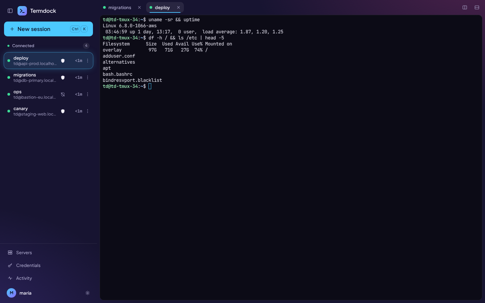
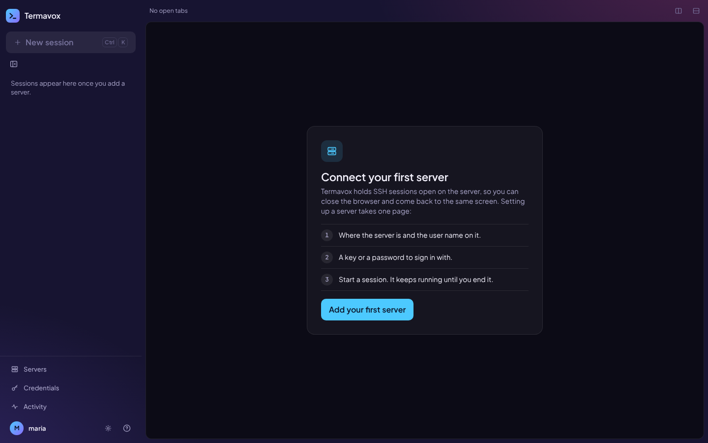
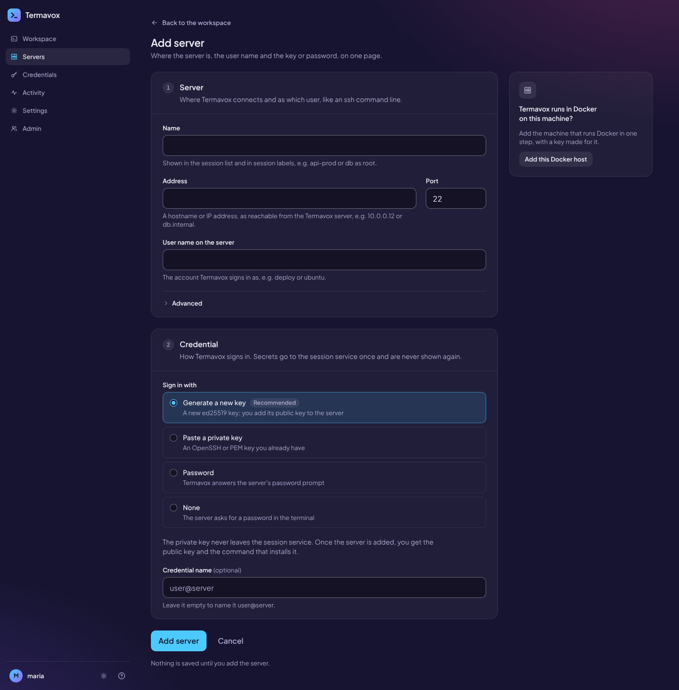
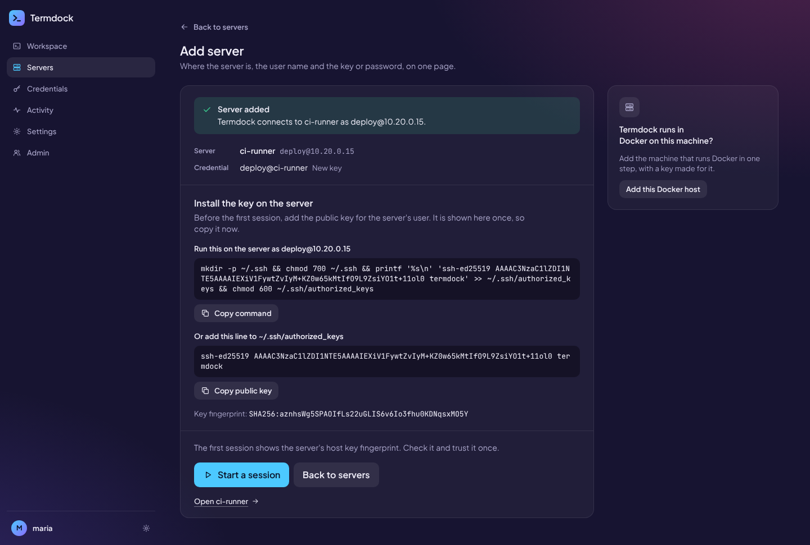
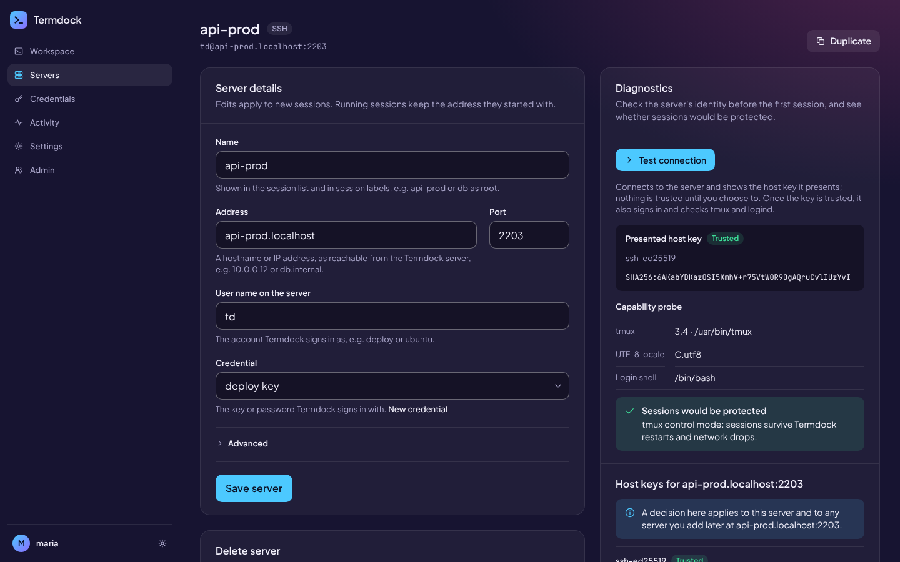
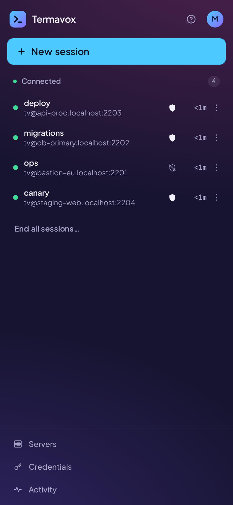
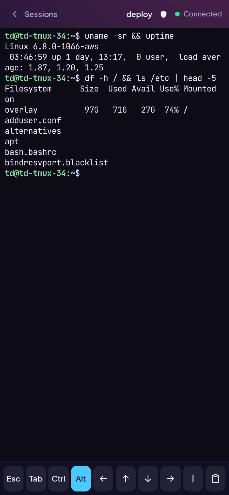

# Screenshots

Real captures of Termavox against test SSH servers: desktop at 1440×900, phone at 390×844 (2x).
They are refreshed when a release changes the UI significantly (`docs/release-checklist.md`).

## Workspace

Named sessions grouped by state on the left, the active one lit in place; a live shell on the
right. Sessions keep running on the server when the browser closes.

## First use

With no server yet, the workspace explains the three steps and offers one action.

## Add server

One page: the server (address, port, user name, and the connection options under Advanced) and
the credential (generate a key, paste one, a password, a saved credential, or none). Nothing is
saved until you submit it.

For a generated key, the result shows the public key with the command that installs it on the
server, and starts a session in one click.

## A server's page

Edit the server, test the connection (host key and capability probe) and manage the host keys of
its address. Duplicate copies the server to change its user or key.

## On the phone

The session list is its own screen; a session opens full screen with an extra-key bar (Esc, Tab,
Ctrl, Alt, arrows, `|`, paste).

  
  

