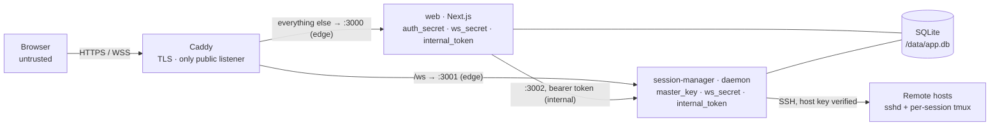

# Security model

This document is for operators who run Termdock and for reviewers who want to know what it
protects, what it does not, and how. It describes the code as of the v0.1.0 preparation. The
design rationale lives in the [implementation plan](implementation-plan.md#10-security); this
page links to it instead of repeating it.

> [!WARNING]
> Termdock is pre-alpha. An internal security review has been completed and its findings fixed
> (see [`CHANGELOG.md`](../CHANGELOG.md)), but there has been no external review and no release
> yet. Keep it away from production servers until v0.1.0.

To report a vulnerability, see [Reporting a vulnerability](#reporting-a-vulnerability).

## What Termdock is, from a security standpoint

Termdock is a **privileged bastion**. It stores SSH credentials for every registered server,
holds SSH sessions open on the server side, and lets browsers type into them. Whoever fully
controls a Termdock instance can reach every server its users registered. Run it, and decide
who may use it, the way you would a jump host.

Inside one instance there are two roles, `admin` and `user`. Every server, credential, session
and host-key decision belongs to exactly one user, and nothing is shared between users (two users
who register the same machine each have their own server and decide on its host key alone).
Admins manage accounts and instance settings. Apart from the audit log, which records credential
names and host-key events of every user, the UI does not show them other users' servers,
credentials or terminals; they are trusted nonetheless (see [Admins](#admins-are-trusted)).

## Components and trust boundaries

| Component | Holds | Notes |
|---|---|---|
| Browser | The auth-session cookie; the terminal view (xterm.js) | Untrusted. Never the source of truth for terminal state; it renders and sends input. |
| Caddy | TLS keys and its local CA (`caddy-data` volume) | The only published service. Routes `/ws` to session-manager and everything else to web. Replaces any client `X-Forwarded-For` with the TCP peer address. Not on the `internal` network, so it cannot reach the internal API. |
| web | `auth_secret`, `ws_secret`, `internal_token` | Control plane: sign-in, users, servers, layout, audit view, WebSocket ticket issuer. Never holds the master key. A secret passes through web only when a user creates a credential, and web can never read one back. |
| session-manager | `master_key`, `ws_secret`, `internal_token`; decrypted credentials, in memory, only while connecting | Data plane: SSH connections, server-side emulators, the WebSocket server, the internal API and the credential vault. Writes every credential and known-host-key row. |
| SQLite (`termdock-data` volume) | Users and argon2id password hashes, TOTP secrets (encrypted by Better Auth), encrypted credentials, host keys, sessions, audit events | Shared by web and session-manager. Assume it can leak through backups: SSH secrets in it are ciphertext only. |
| `deploy/secrets/` | The four secret files | Mounted read-only into the containers as Docker secrets. `master_key` is mounted into session-manager only. |
| Remote hosts | The user's shell and a per-session tmux server | Reached over SSH with strict host-key verification. Termdock installs nothing on them. |

The boundaries, from the outside in ([plan §4.4](implementation-plan.md#44-trust-boundaries)):

1. **Browser ↔ Caddy**: untrusted. TLS, authentication, `Origin` checks on every state-changing
   request and on the WebSocket upgrade.
2. **web ↔ session-manager**: semi-trusted. Only on the `internal` compose network (no gateway,
   no outside connectivity), authenticated with a shared bearer token. The daemon re-validates
   the acting user's ownership of every resource itself.
3. **session-manager ↔ remote hosts**: authenticated SSH. A host key is trusted only after an
   explicit user decision, and a changed key fails hard.
4. **The database file**: may leak. Secrets inside it are encrypted with a key that is not in it.

What Termdock runs on a remote host: one capability probe per connection (an `exec sh -c '…'`
that reads `$SHELL`, the tmux path and version, a UTF-8 locale, terminfo and the systemd-logind
settings), and, for protected sessions, one tmux server per session on its own socket
(`tmux -L td-<installation>-<token> -f /dev/null -C …`), so the user's own tmux configuration
and sessions are never touched. With logind's `KillUserProcesses=yes` and linger enabled, tmux
is started through `systemd-run --user --scope`.

## Threat model

The summary table is in [plan §10.1](implementation-plan.md#101-threat-model-summary). In short:

### What Termdock protects against

- **A leaked database or backup.** SSH passwords, private keys and passphrases are stored with
  AES-256-GCM under a master key that lives outside the database. Account passwords are argon2id
  hashes, and Better Auth encrypts TOTP secrets with web's `auth_secret`. Usernames, host names,
  fingerprints, session history and audit rows are not encrypted.
- **Other Termdock users.** A user can only list, attach to, type into or manage their own
  sessions, servers, credentials and host-key decisions, both in web and in the daemon.
- **Forged or replayed WebSocket connections.** The upgrade must carry the instance's `Origin`,
  and the first frame must present a 30-second, single-use ticket signed by web and bound to the
  user and the auth session.
- **Online password guessing.** argon2id, Better Auth's per-IP rate limiter, a progressive
  lockout per (username, client IP), and optional or mandatory TOTP.
- **Man-in-the-middle on SSH.** Explicit trust on first use, a hard failure on mismatch, revoked
  keys that fail closed, and SHA-2 host-key signatures only.
- **Hostile output from a remote host.** Terminal titles, hyperlinks, clipboard writes, terminal
  queries and keyboard-interactive prompt text are filtered or framed (see
  [Terminal escape handling](#terminal-escape-handling)), and the scan for leftover tmux servers
  reads only numbers through a strict parser (see [Remote tmux leftovers](#remote-tmux-leftovers)).
- **Using the daemon to reach its own machine.** SSH targets on loopback, link-local,
  multicast, unspecified or the daemon's own addresses are refused by default.
- **Script injection in the UI.** A strict, nonce-based Content-Security-Policy.
- **Takeover of a fresh instance.** The first admin can only be created with a one-time token
  printed in web's logs.
- **One user exhausting the daemon.** Per-user and per-connection caps, bounded buffers, and
  memory and process limits per container.

### What it does not protect against

These are accepted limits of the design. Plan the deployment around them.

#### A compromised web process

web holds the WebSocket ticket key and the internal API token, so an attacker who runs code in
the web container can mint tickets for any user and drive their terminals, and can call the
internal API as any acting user. It cannot read the master key or decrypt stored secrets, but
it sees new credentials as users submit them. It can also point a server at an attacker-controlled
sshd, trust that sshd's host key through the internal API, and start a session with a stored
**password** credential: the daemon then sends the password to the attacker. Private keys are not disclosed this way, because an SSH
public-key signature is bound to the session it was made for (plan T-09 in the
[decision log](implementation-plan.md#22-technical-decisions-orchestrator-reversible-with-rationale)).
**Use key credentials for high-value hosts.** web can also read the whole database, including
password hashes, decrypt TOTP secrets with its `auth_secret`, and write the rows it owns,
including its audit rows.

#### Admins are trusted

An admin can set a temporary password for any user and reset their TOTP, then sign in as that
user. Both actions are audited (`auth.password_reset`, `auth.totp_reset`), and the user finds
out at their next sign-in, but nothing technical stops it. Better Auth's impersonation endpoints
are disabled, so an admin cannot act as another user silently. Keep the number of admins small.

**Local direct mode** (Phase 6, not implemented yet) would run shells as the daemon's OS user,
which can read the master key and the database: enabling it would give admins effective access
to the vault ([plan §10.1](implementation-plan.md#101-threat-model-summary)). Today the daemon
refuses every local session, whatever its settings, and the compose deployment fixes
`TERMDOCK_ENABLE_LOCAL_SHELL=false`.

#### The master key together with the database

Anyone who holds both `master_key` and a copy of `app.db` (or a backup) can decrypt every stored
credential. Keep the key apart from the database backups, and restrict who can read
`deploy/secrets/`.

#### A compromised session-manager or Docker host

session-manager holds the master key and every live SSH connection: compromising it is game over
by design, as with any bastion. Anyone with root or Docker access on the host can read the
secrets, the volumes and the containers' memory.

#### Other limits

- TOTP codes can be replayed within their validity window (about 90 s); there is no used-code
  cache ([ADR-0004](adr/0004-auth-better-auth.md#other-findings)).
- The sign-in lockout and Better Auth's rate limiter keep their state in web's memory: a web
  restart clears them.
- web trusts `X-Forwarded-For` because only Caddy can reach it. Anyone who can connect to
  `web:3000` directly can spoof the client IP and weaken the lockout, the rate limits and the
  audit trail.
- Audit and session-event rows are kept for 180 days by default
  (`TERMDOCK_EVENT_RETENTION_DAYS`; `0` keeps them forever). Older rows are deleted for good:
  raise the setting, or keep database backups, if you need a longer trail.
- Terminal sessions keep running when a user is disabled, unless the admin also terminates them.

## Controls

### Authentication

web uses [Better Auth](adr/0004-auth-better-auth.md) with the `username`, `twoFactor` and `admin`
plugins.

- **Accounts.** Public sign-up and email sign-in are disabled; users are created by an admin
  with a temporary password that must be changed at first sign-in. Passwords are 12 to 128
  characters, hashed with argon2id (19 MiB, t = 2, p = 1) through Node's `crypto.argon2`. Users
  cannot rename themselves.
- **First admin.** While no user exists, web generates a 192-bit setup token, logs it once at
  WARN with the `/setup` URL, and keeps only its SHA-256 in memory. Setup closes for good once
  the first admin exists. Treat web's logs as sensitive until then.
- **TOTP.** Optional per user; an admin can require it per user or instance-wide
  (`require_totp`), which forces enrollment before anything else opens. A trusted device skips
  the second step for 30 days. Admins can reset a user's TOTP.
- **Lockout.** 5 failed sign-ins for one (username, client IP) pair lock that pair for 30 s,
  doubling with each further failure up to 15 min. A locked attempt is refused before the
  password is checked (`429` with `Retry-After`). Unknown usernames are locked the same way, so
  the lockout does not reveal which accounts exist. Second-factor failures have their own
  lockout in Better Auth (10 failures lock the account for 15 min).
- **Rate limits.** Better Auth's limiter is enabled in every environment, in memory, per IP
  (sign-in: 3 requests per 10 s).
- **Auth sessions.** Cookies are `HttpOnly; Secure; SameSite=Strict` with the `__Secure-`
  prefix, valid for 7 days and slid forward at most once a day; the open workspace keeps them
  sliding. Closing the browser does not sign you out. Every check reads the `auth_session`
  table, so revocation is immediate.
- **Pending requirements.** While a password change or TOTP enrollment is pending, pages and
  Server Actions redirect to it, Better Auth answers only a short allowlist of endpoints, and no
  WebSocket ticket is issued.
- **Disabled users** are Better Auth `banned` users: their auth sessions are deleted, sign-in
  is refused, and both web and the daemon re-check the ban (honouring its expiry).

### Authorization and isolation

- In web, only the user-scoped repository layer (`apps/web/lib/repo`) and the auth core may
  import the database client; a Biome `noRestrictedImports` rule enforces it for the rest of
  `apps/web`. Mutations are Server Actions that re-check the session and ownership.
- The daemon re-checks ownership itself instead of relying on web's checks. Every user-scoped
  internal API call carries `actingUserId`; the daemon checks that the user exists and is not
  disabled (else `403`) and answers a foreign session, server or credential with `404`, exactly
  like a missing one. Host-key decisions are looked up by the acting user (or the session's
  owner) and an address, so one user's decisions can neither be read nor changed through
  another user's server.
- Every WebSocket `session.attach`, host-key decision and prompt answer is checked against the
  session's owner. A non-owner gets `FORBIDDEN` without learning whether the session exists.
- Admin-only internal API calls (terminating another user's sessions) re-check the acting
  user's role in the database.
- Remote tmux leftovers: a session that runs in Termdock, whoever owns it, and every ended
  session of another user are never listed, ended or adopted from a server page (see
  [Remote tmux leftovers](#remote-tmux-leftovers)).

### WebSocket tickets

Browsers reach session-manager directly through Caddy (`/ws`); WebSockets never go through
Next.js. Details: [plan §7.1](implementation-plan.md#71-connection-and-authentication).

1. The browser calls `POST /api/ws/ticket`. web requires the instance's `Origin`, a valid auth
   session and no pending requirement, then returns a ticket with `Cache-Control: no-store`.
2. The ticket is `base64url(payload).base64url(HMAC-SHA256(ws_secret, payload))`, with payload
   `{ v: 1, uid, asid, exp, nonce }`. It expires after 30 s and is single-use: the daemon
   remembers each nonce until the ticket expires.
3. The daemon rejects an upgrade whose `Origin` differs from `TERMDOCK_PUBLIC_URL`'s origin
   (close `4403`), and closes a connection that does not send a valid `hello` within 5 s
   (`4401`).
4. It checks that the auth session still exists, has not expired and belongs to a user who is
   not disabled, at `hello` and again every 60 s. A sign-out, password change, admin password or
   TOTP reset, or disabling a user closes the affected WebSockets at once through the internal
   API (`auth-sessions/revoke`).

### Internal API bearer

session-manager's internal API (`:3002`) serves web only. In the compose deployment it listens
on the address of the `session-manager-internal` alias, which exists only on the `internal`
network; Caddy is not on that network. Every request, health included, needs
`Authorization: Bearer <internal_token>`. The comparison hashes both values with SHA-256 and
compares the digests in constant time, so neither the token nor its length leaks through timing.
Bodies are JSON of at most 64 KiB, validated with zod. Routes:
[plan §8.3](implementation-plan.md#83-internal-api-session-manager-3002).

### Credential vault and key rotation

- **Encryption.** AES-256-GCM, a fresh 96-bit random nonce per record, 128-bit tag. The
  plaintext is a JSON envelope (`password`, or `privateKey` plus optional `passphrase`). The
  additional authenticated data binds each ciphertext to its credential id, owner, kind and key
  version, so a ciphertext copied to another row fails to decrypt.
- **Master key.** `TERMDOCK_MASTER_KEY_FILE`: base64 of exactly 32 random bytes. The daemon
  stores a key-check value in `instance_settings` (`vault_key_check`) on first boot and refuses
  to start when the key does not match it.
- **Who decrypts.** Only session-manager, and only to connect. web forwards a new credential to
  the internal API when the user creates it and never receives a secret back. Private keys are parsed with ssh2 before
  they are stored; generated keys are ed25519. The UI never shows a secret after creation.
- **Rotation.** A `vault rotate` command of session-manager and the wrapper script
  `deploy/scripts/rotate-master-key.sh` re-encrypt every stored credential under a new master
  key. Follow [Rotating the master key](guides/install.md#rotating-the-master-key) in the
  installation guide.

### Host-key trust

Details: [plan §5.9](implementation-plan.md#59-host-key-verification).

- **Per user and address.** Decisions are stored like OpenSSH's `known_hosts`: for one user, the
  hostname as typed (normalized: trimmed, lowercased, IPv6 without brackets) and the port. A
  decision made through one server applies to every server of that user with the same address;
  a DNS name and an IP of the same machine are two addresses, and another port is another
  address. Decisions are never shared between users, and they outlive the servers (no foreign
  key, no purge): deleting a server and adding it again never lets a revoked key back in. A
  session whose server was deleted never connects again through its snapshot.
- **First use.** An unknown key is stored as `pending`, the connection is aborted, and the
  session waits in "Action required" with the key's `SHA256:` fingerprint. Only the owner's
  explicit accept trusts exactly that key; pending keys expire after 24 h (the only decisions
  with a lifetime). Owners can also pre-trust a fingerprint, or use **Fetch & verify** on the
  server page before any session exists. Fetch & verify signs in (with the server's user name
  and credential) only once the key is trusted; for a server without a stored credential it
  stops after the host key, so no failed login reaches the host.
- **Mismatch.** A key that differs from the trusted one fails the session with
  `HOST_KEY_MISMATCH`. There is no in-flow accept: the owner must use "Replace trusted key" on
  the server page and type the server's hostname to confirm, since the change applies to every
  one of their servers with that address.
- **Revoked keys fail closed.** A key the owner revoked is refused like a mismatch, also when no
  other key is trusted; it is never offered as a first-use prompt and can only be trusted again
  through the replace flow. The event is audited as `host_key.revoked_presented`.
- **Algorithms.** Host keys are verified with SHA-2 signatures only; `ssh-rsa` (SHA-1) is never
  offered. There is no `StrictHostKeyChecking=no` equivalent anywhere, including tests.

### SSH target policy

Users choose the addresses the daemon connects to, so the daemon resolves each host name itself,
once, and connects only to an address that passed the check. By default it refuses, for sessions
and for Fetch & verify: loopback (`127.0.0.0/8`, `::1`), link-local (`169.254.0.0/16`, home of
cloud metadata services, and `fe80::/10`), unspecified (`0.0.0.0/8`, `::`), multicast, and the
addresses of its own network interfaces, IPv4-mapped forms included. Private LAN ranges and the
Docker host behind `host.docker.internal` stay allowed. A refused session fails with
`TARGET_NOT_ALLOWED` and is not retried. Fetch & verify is limited to 10 checks per user per
minute.

`TERMDOCK_SSH_ALLOW_LOCAL_TARGETS=true` turns the policy off, for example when session-manager
runs outside Docker and should reach an sshd on the same machine. See the
[installation guide](guides/install.md#ssh-targets).

### Remote tmux leftovers

Details: [plan §6.12](implementation-plan.md#612-remote-leftovers-d-30). A protected session's
tmux server keeps running on its server while Termdock is down; Termdock ends the ones it
forgot (a session ended while not connected, a database reset) and lists the rest on the server
page with **End** and **Adopt**.

- **Who may touch what.** The daemon classifies every Termdock tmux server it finds against the
  session records of all users. One that belongs to a session that runs in Termdock (any user's)
  or to an ended session of another user is never listed, ended or adopted. Only the acting
  user's own ended sessions are ended automatically, and only once they ended at least 60 s ago
  (a Reopen in between wins); every kill is classified again against the database right before
  it runs. End and Adopt refuse (`409`) what they may not touch, and two adoptions of one
  server cannot both succeed (the check runs inside the insert's transaction).
- **Host output is untrusted.** The scan reports a socket name and three numbers per tmux server
  (created, last activity, attached clients): no session name, pane command or title is read.
  The parser caps the output (64 KiB), the line length and the number of entries (200), and
  drops every name that is not exactly `td-<prefix>-<token>`; the script itself skips names with
  characters that could break the line format. A scan never starts, kills or removes anything.
- **Same sign-in rules, never a prompt.** The one-shot connection that ends a terminated
  session's tmux, the background sweep (on a session's own connection) and the server page's
  calls use the stored credential and the user's trusted key for the address. The one-shot
  cleanup fails closed on an unknown, mismatched or revoked key and records nothing as pending;
  the server page records an unknown key as pending, exactly like Fetch & verify. A server
  without a stored credential is not contacted at all (`CREDENTIAL_REQUIRED`), so no failed
  login reaches the host.
- **Bounded.** At most 4 one-shot cleanups run at once in the process, one sweep per user,
  address and user name every 15 minutes, and 20 server-page lists or ends per user and minute;
  every remote step has a timeout.

### Keyboard-interactive prompts

When a host asks for a one-time code or another keyboard-interactive answer, the prompt is
relayed to the owner's browser ([plan §5.10](implementation-plan.md#510-keyboard-interactive-relay)).

- The text comes from the host, so the daemon caps it (name 256, instructions 2048, each prompt
  256 characters, at most 16 prompts) and strips control characters and invisible formatting
  (zero-width and bidi characters). The browser panel always shows Termdock's own title and
  "Host user@host asks:", with the host's text quoted beneath it, never as the panel's own words.
- A single password prompt is answered automatically from a stored password credential, at most
  once per connection attempt. Everything else waits for the user for 100 s; then the connection
  closes and the next attempt starts only when someone can answer, so there are no unattended
  login loops against the host.
- Answers are never logged, stored or echoed back.

### Terminal escape handling

Remote programs control what they print, so the browser treats terminal output as hostile.

- **Clipboard (OSC 52).** Remote clipboard writes are off by default; each user can opt in under
  terminal settings. Clipboard reads are never answered.
- **Links (OSC 8 and plain-text URLs).** Both go through the same handler: only `http` and
  `https` open, only after a confirmation that shows the full URL (on by default), and always in
  a new tab with `noopener,noreferrer`. xterm never opens a link by itself.
- **Terminal queries.** Device attributes, cursor and status reports, mode, version and color
  queries are answered exactly once: by tmux for protected sessions, by the server emulator
  otherwise. The browser never answers, so output cannot make a viewer's browser type
  into the session.
- **Titles.** Window titles are stripped of control characters and invisible formatting and cut
  to 256 characters by the daemon, and cleaned again by the browser.
- Terminal output is never interpreted as HTML; no escape sequence reaches the DOM.

### Content-Security-Policy and headers

- **Pages** get a per-request nonce CSP: `default-src 'self'; script-src 'self' 'nonce-…'
  'strict-dynamic'; style-src 'self' 'unsafe-inline'; img-src 'self' blob: data:; font-src
  'self'; connect-src 'self'; object-src 'none'; base-uri 'none'; form-action 'self';
  frame-ancestors 'none'`. `style-src` allows inline styles because xterm's DOM renderer injects
  them. Development builds add `'unsafe-eval'`.
- **API routes** get `default-src 'none'; frame-ancestors 'none'`.
- **Every web response** carries `Referrer-Policy: no-referrer`,
  `X-Content-Type-Options: nosniff`,
  `Permissions-Policy: camera=(), microphone=(), geolocation=(), payment=(), usb=()` and
  `Cross-Origin-Opener-Policy: same-origin`, and no `X-Powered-By`.
- **Caddy** adds `Strict-Transport-Security: max-age=31536000` for every name except
  `localhost`, and removes its `Server` header.
- **CSRF.** Auth cookies are `SameSite=Strict`. Server Actions check the origin; the ticket and
  layout route handlers compare `Origin` with `TERMDOCK_PUBLIC_URL`'s origin exactly; Better
  Auth trusts only that origin.

### Containers and resource limits

From [`deploy/compose.yaml`](../deploy/compose.yaml) and the Dockerfiles:

- Every service: read-only root filesystem, all Linux capabilities dropped,
  `no-new-privileges`, a `/tmp` tmpfs. Caddy keeps only `NET_BIND_SERVICE`.
- web and session-manager run as UID/GID `10001` with an init process. Application files are
  owned by root, so the app user cannot modify them; `npm`, `npx`, `corepack` and `yarn` are
  removed from the runtime images. The only writable paths are `/data`, `/tmp` and (web) the
  `.next/cache` tmpfs.
- Base images are pinned by digest. Dependency build scripts are blocked (pnpm `allowBuilds`).
- Only Caddy publishes ports. web and session-manager have none; the `internal` network has no
  outside connectivity. No container mounts the Docker socket.
- Memory limits: Caddy 256 MiB, web `TERMDOCK_WEB_MEM_LIMIT` (768m), session-manager
  `TERMDOCK_DAEMON_MEM_LIMIT` (1g). Process limits: 128, 256 and 512.
- Daemon caps per user: 16 WebSocket connections (the next closes with `4429`), 64 attached
  terminals across them (more attaches get `RATE_LIMITED`), and the admin setting
  `max_running_sessions_per_user` (default 50). Per connection: 32 channels (one more closes it
  with `4400`), 64 messages in flight (`4429`), 1 MiB per client frame. A runtime whose session
  is not meant to run and has no viewer is freed after 60 s. Output to a slow browser stops at
  2 MiB buffered and resumes with a fresh snapshot; capability-probe output is read up to 64 KiB.

### Logging and redaction

- session-manager logs JSON (pino) to stdout at `TERMDOCK_LOG_LEVEL`. web logs plain lines to
  stdout.
- **Terminal contents are never logged.** The code does not log terminal input or output bytes,
  keyboard-interactive answers, tickets or credential material.
- As a safety net, both processes censor these keys wherever they appear in structured log
  fields: `ticket`, `answers`, `password`, `passphrase`, `privateKey`, `secret`, `payload`,
  `data`, `input`, `env`, `policies`, `authorization`, `cookie`, `token`. web also censors them
  in JSON embedded in log messages.
- Logs do contain user ids, usernames (for example in lockout warnings) and client IP
  addresses, and web logs the one-time setup token until the first admin exists. Treat container
  logs as sensitive.

### Audit

- `audit_events`, viewable by admins at `/admin/audit`:
  - written by web: `auth.login_success`, `auth.login_failure`, `auth.lockout`,
    `auth.password_change`, `auth.password_reset`, `auth.totp_enable`, `auth.totp_disable`,
    `auth.totp_reset`, `auth_session.revoke`, `user.create`, `user.ban`, `user.unban`,
    `user.role_change`, `user.sessions_terminate`, `admin_setting.change`;
  - written by session-manager: `credential.create`, `credential.rename`, `credential.delete`,
    `host_key.pending`, `host_key.trust`, `host_key.replace`, `host_key.revoke`,
    `host_key.mismatch`, `host_key.revoked_presented`, `session.rename`,
    `remote_session.terminated` and `remote_session.adopted` (the server, the tmux socket name
    and how it was classified).
- `session_events`, shown to each user at `/activity`: creation, state changes, attach and
  detach (with client IP and user agent), connection loss, protection selected or degraded,
  restore and reopen, host-key and prompt events, and remote tmux cleanups
  (`remote_cleanup`, `remote_cleanup_failed` with its code, `adopt_target_gone`).
- Rows carry public data only (ids, names, roles, fingerprints, setting values), never a
  password, code or key. Client IPs come from Caddy's `X-Forwarded-For`; session-manager believes
  it only from `TERMDOCK_TRUSTED_PROXIES` and takes the rightmost value that is not a trusted
  proxy.
- Retention: session-manager deletes rows of both tables older than
  `TERMDOCK_EVENT_RETENTION_DAYS` (default 180 days; `0` keeps them forever), a few minutes after
  it starts and every 6 hours, oldest first and 500 rows per transaction. The purge covers every
  row, including the audit events web writes, and logs only the per-table counts
  ([Event retention](guides/configuration.md#event-retention)).

## Operator recommendations

- **Expose only Caddy.** Never publish `web:3000`, `session-manager:3001` or `:3002`, and do not
  put another proxy in front of web that it does not know about.
- **Use real TLS.** Prefer a public domain with ACME. With Caddy's local CA, import its root
  certificate on each client instead of clicking through warnings.
- **Protect the master key.** Back up `deploy/secrets/master_key` separately from the database
  backups; both together decrypt every credential. Store backups like secrets. Rotate the key if
  it may have leaked.
- **Limit host access.** Membership in the `docker` group is root on the host: it can read every
  secret and volume.
- **Require TOTP** for everyone (`/admin/settings`), and keep the number of admins small.
- **Prefer key credentials** for high-value hosts, and verify host-key fingerprints out of band
  or pre-trust them.
- **Keep the defaults** `TERMDOCK_SSH_ALLOW_LOCAL_TARGETS=false` and
  `TERMDOCK_ENABLE_LOCAL_SHELL=false` unless you need otherwise.
- **Finish setup promptly** and treat logs as sensitive until the first admin exists.
- **Rebuild regularly** to pick up base-image and dependency fixes, and review the audit log.

## Reporting a vulnerability

Termdock does not have a dedicated security contact yet; the maintainers will add one to
[`SECURITY.md`](../SECURITY.md) before the first release. Until it is published, please do not
post vulnerability details in public issues, pull requests or discussions.
