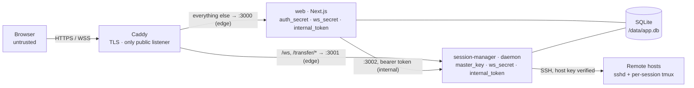

# Security model

This document is for operators who run Termavox and for reviewers who want to know what it
protects, what it does not, and how. It describes the code as of the v0.1.0 preparation. The
design rationale lives in the [implementation plan](implementation-plan.md#10-security); this
page links to it instead of repeating it.

> [!WARNING]
> Termavox 0.1.0 is the first supported release. Read this page before you expose it to the
> internet or use it with production servers.

To report a vulnerability, see [Reporting a vulnerability](#reporting-a-vulnerability).

## What Termavox is, from a security standpoint

Termavox is a **privileged bastion**. It stores SSH credentials for every registered server,
holds SSH sessions open on the server side, and lets browsers type into them. Whoever fully
controls a Termavox instance can reach every server its users registered. Run it, and decide
who may use it, the way you would a jump host.

Inside one instance there are two roles, `admin` and `user`. Every server, credential, session
and host-key decision belongs to exactly one user, and nothing is shared between users (two users
who register the same machine each have their own server and decide on its host key alone).
Admins manage accounts and instance settings. Apart from the audit log, which records credential
names and host-key events of every user, the UI does not show them other users' servers,
credentials or terminals; they are trusted nonetheless (see [Admins](#admins-are-trusted)).

## Components and trust boundaries

| Component | Holds | Notes |
|---|---|---|
| Browser | The auth-session cookie; the terminal view (xterm.js) | Untrusted. Never the source of truth for terminal state; it renders and sends input. |
| Caddy | TLS keys and its local CA (`caddy-data` volume) | The only published service. Routes `/ws` and the file panel's `/transfer/*` to session-manager and everything else to web. Replaces any client `X-Forwarded-For` with the TCP peer address, or, behind a reverse proxy named in `TERMAVOX_REVERSE_PROXY`, with the address that proxy forwarded (read right to left). Not on the `internal` network, so it cannot reach the internal API. |
| web | `auth_secret`, `ws_secret`, `internal_token` | Control plane: sign-in, users, servers, layout, audit view, WebSocket ticket issuer. Never holds the master key. A secret passes through web only when a user creates a credential, and web can never read one back. |
| session-manager | `master_key`, `ws_secret`, `internal_token`; decrypted credentials, in memory, while the SSH connection that uses them is open | Data plane: SSH connections, server-side emulators, the WebSocket server, the internal API and the credential vault. Writes every credential and known-host-key row. |
| SQLite (`termavox-data` volume) | Users and argon2id password hashes, TOTP secrets (encrypted by Better Auth), encrypted credentials, host keys, sessions, audit events | Shared by web and session-manager. Assume it can leak through backups: SSH secrets in it are ciphertext only. |
| `deploy/secrets/` | The four secret files | Mounted read-only into the containers as Docker secrets. `master_key` is mounted into session-manager only. |
| Remote hosts | The user's shell and a per-session tmux server | Reached over SSH with strict host-key verification. Termavox installs nothing on them. |

The boundaries, from the outside in ([plan §4.4](implementation-plan.md#44-trust-boundaries)):

1. **Browser ↔ Caddy**: untrusted. TLS, authentication, `Origin` checks on every state-changing
   request and on the WebSocket upgrade.
2. **web ↔ session-manager**: semi-trusted. Only on the `internal` compose network (no gateway,
   no outside connectivity), authenticated with a shared bearer token. The daemon re-validates
   the acting user's ownership of every resource itself.
3. **session-manager ↔ remote hosts**: authenticated SSH. A host key is trusted only after an
   explicit user decision, and a changed key fails hard.
4. **The database file**: may leak. Secrets inside it are encrypted with a key that is not in it.

What Termavox runs on a remote host: one capability probe per connection (an `exec sh -c '…'`
that reads `$SHELL`, the tmux path and version, a UTF-8 locale, terminfo and the systemd-logind
settings), and, for protected sessions, one tmux server per session on its own socket
(`tmux -L tv-<installation>-<token> -f /dev/null -C …`), so the user's own tmux configuration
and sessions are never touched. With logind's `KillUserProcesses=yes` and linger enabled, tmux
is started through `systemd-run --user --scope`. While someone uses a session's Files panel, the
daemon also opens an SFTP channel on that session's own connection: the server's SFTP subsystem
(`sftp-server` or `internal-sftp`) runs as the session's user, with that user's permissions.

## Threat model

The summary table is in [plan §10.1](implementation-plan.md#101-threat-model-summary). In short:

### What Termavox protects against

- **A leaked database or backup.** SSH passwords, private keys and passphrases are stored with
  AES-256-GCM under a master key that lives outside the database. Account passwords are argon2id
  hashes, and Better Auth encrypts TOTP secrets with web's `auth_secret`. Usernames, host names,
  fingerprints, session history and audit rows are not encrypted.
- **Other Termavox users.** A user can only list, attach to, type into or manage their own
  sessions, servers, credentials and host-key decisions, both in web and in the daemon.
- **Forged or replayed WebSocket connections.** The upgrade must carry the instance's `Origin`,
  and the first frame must present a 30-second, single-use ticket signed by web and bound to the
  user and the auth session.
- **Online password guessing.** argon2id, a sign-in budget per client IP, a progressive lockout
  per (username, client IP), and optional or mandatory TOTP.
- **Man-in-the-middle on SSH.** Explicit trust on first use, a hard failure on mismatch, revoked
  keys that fail closed, and SHA-2 host-key signatures only.
- **Hostile output from a remote host.** Terminal titles, hyperlinks, clipboard writes, terminal
  queries and keyboard-interactive prompt text are filtered or framed (see
  [Terminal escape handling](#terminal-escape-handling)), the scan for leftover tmux servers
  reads only numbers through a strict parser (see [Remote tmux leftovers](#remote-tmux-leftovers)),
  tmux control-mode replies are size-capped, and host text quoted in the daemon's errors, logs
  and session events is cleaned and cut short (see [Logging and redaction](#logging-and-redaction)).
- **Using the daemon to reach its own machine.** SSH targets on loopback, link-local,
  multicast, unspecified or the daemon's own addresses are refused by default.
- **Script injection in the UI.** A strict, nonce-based Content-Security-Policy.
- **Takeover of a fresh instance.** The first admin can only be created with a one-time token
  printed in web's logs.
- **One user exhausting the daemon.** Per-user and per-connection caps, bounded buffers, and
  memory and process limits per container.

### What it does not protect against

These are accepted limits of the design. Plan the deployment around them.

#### A compromised web process

web holds the WebSocket ticket key and the internal API token, so an attacker who runs code in
the web container can mint tickets for any user and drive their terminals, and can call the
internal API as any acting user. It cannot read the master key or decrypt stored secrets, but
it sees new credentials as users submit them. It can also point a server at an attacker-controlled
sshd, trust that sshd's host key through the internal API, and start a session with a stored
**password** credential: the daemon then sends the password to the attacker. Private keys are not disclosed this way, because an SSH
public-key signature is bound to the session it was made for (plan T-09 in the
[decision log](implementation-plan.md#22-technical-decisions-orchestrator-reversible-with-rationale)).
**Use key credentials for high-value hosts.** web can also read the whole database, including
password hashes, decrypt TOTP secrets with its `auth_secret`, and write the rows it owns,
including its audit rows.

#### Admins are trusted

An admin can set a temporary password for any user and reset their TOTP, then sign in as that
user. Both actions are audited (`auth.password_reset`, `auth.totp_reset`), and the user finds
out at their next sign-in, but nothing technical stops it. Better Auth's impersonation endpoints
are disabled and its other admin endpoints are not served over HTTP, so an admin cannot act as
another user silently or bypass the audited admin pages. Keep the number of admins small.

Whoever can run Docker commands on the host can do the same without an account:
`deploy/scripts/reset-password.sh` sets a temporary password for any user, and with `--reset-totp`
also resets their TOTP (plan D-36), for when no admin can sign in. It adds no power that host access lacked (the database and the master key are
already within reach), and the reset is audited the same way, without an actor.

**Local direct mode** (Phase 6, not implemented yet) would run shells as the daemon's OS user,
which can read the master key and the database: enabling it would give admins effective access
to the vault ([plan §10.1](implementation-plan.md#101-threat-model-summary)). Today the daemon
refuses every local session, whatever its settings, and the compose deployment fixes
`TERMAVOX_ENABLE_LOCAL_SHELL=false`.

#### The master key together with the database

Anyone who holds both `master_key` and a copy of `app.db` (or a backup) can decrypt every stored
credential. Keep the key apart from the database backups, and restrict who can read
`deploy/secrets/`.

#### A compromised session-manager or Docker host

session-manager holds the master key and every live SSH connection: compromising it is game over
by design, as with any bastion. Anyone with root or Docker access on the host can read the
secrets, the volumes and the containers' memory.

#### Other limits

- TOTP codes can be replayed within their validity window (about 90 s); there is no used-code
  cache ([ADR-0004](adr/0004-auth-better-auth.md#other-findings)).
- The sign-in lockout and the per-IP sign-in budget keep their state in web's memory: a web
  restart clears them. Users behind one address (a NAT, an unnamed reverse proxy) share one
  budget.
- web trusts `X-Forwarded-For` because only Caddy can reach it. Anyone who can connect to
  `web:3000` directly can spoof the client IP and weaken the lockout, the rate limits and the
  audit trail.
- Behind a reverse proxy (`TERMAVOX_TLS=off`), Caddy believes the proxy's `X-Forwarded-For` only
  from `TERMAVOX_REVERSE_PROXY`, and answers `503` while that setting is empty (every client
  would otherwise share the proxy's address). Naming too wide a range (for example a whole public
  subnet) lets anyone in it choose their apparent address; and a port published on every
  interface lets clients skip the proxy, so publish it on loopback
  (`TERMAVOX_BIND_ADDRESS=127.0.0.1`) or firewall it.
- On a host with IPv6, Docker forwards IPv6 clients to the IPv4-only `edge` network through its
  userland proxy, from the network's gateway address: Termavox sees them as one client, with one
  sign-in lockout, one rate limit and one address in the logs. Publish on IPv4 only
  (`TERMAVOX_BIND_ADDRESS=0.0.0.0`) or put a reverse proxy in front if users connect over IPv6.
- Audit and session-event rows are kept for 180 days by default
  (`TERMAVOX_EVENT_RETENTION_DAYS`; `0` keeps them forever). Older rows are deleted for good:
  raise the setting, or keep database backups, if you need a longer trail.
- Terminal sessions keep running when a user is disabled, unless the admin also terminates them.
- The file panel's bounds on what a server answers ([File panel transfers](#file-panel-transfers))
  are per request, and one user's requests together can still hold more memory than
  session-manager has. Each of a user's WebSocket connections (16) runs up to 8 file requests at
  once. A delete may hold the names it has read: up to 32 MiB counted in UTF-8, which can take
  about twice that (roughly 64 MiB) in memory. A listing may hold its 2 MiB of names and link
  texts plus the entries' other fields, and its answer grows to about 13 MiB when the names are
  control characters escaped for JSON. 128 such requests are far beyond session-manager's memory
  limit (`TERMAVOX_DAEMON_MEM_LIMIT`, 1 GiB by default), so a user who points the panel at a
  server they control, or at many very large folders at once, can still make it run out of memory,
  which interrupts every user's sessions until it has restarted. A server can also keep one of its
  user's listings or deletes busy until a limit or a cancel stops it, and file answers to a
  browser that stops reading are not capped the way terminal output is.
- SFTP names every entry by path and has no way to open a folder without following a link, so
  the file panel cannot defend against another local user of the session's server who can rename
  entries in a folder it works in (write access to a folder without the sticky bit, or a folder
  of their own). If such a user puts a link in place of a folder being deleted (the folder named
  in the request, or any folder inside it) at any time during the delete, the remaining requests
  below that folder go through the link and delete inside its target, as far as the session's
  user may delete there. What limits it: Delete never follows a link it finds while listing (it
  removes the link itself), and it lists each folder once, right after the `lstat` that found it
  to be a folder. Uploads set their permission bits on the open temporary file, never by path, so
  such a user cannot redirect a permission change or a write; but the final rename goes by path,
  so in the upload's folder they can swap the temporary file for their own file or link just
  before the rename, and that is what ends up under the name.
- The file panel marks hidden characters in names, not look-alikes: letters of other scripts that
  look like Latin ones are not marked, a run of ordinary spaces inside a name collapses on the
  page (`a  b` reads as `a b`), and the rename and path fields show the raw text. Names that use
  hidden characters legitimately show the placeholder too, with the exact form in the tooltip:
  emoji sequences with a zero-width joiner, a variation selector or tag characters (the England,
  Scotland and Wales flags), Persian words with a zero-width non-joiner, names with no-break spaces
  (French typography) or ideographic spaces (Japanese), Mongolian variation selectors, Khmer
  inherent vowels and the braille blank.

## Controls

### Authentication

web uses [Better Auth](adr/0004-auth-better-auth.md) with the `username`, `twoFactor` and `admin`
plugins.

- **Accounts.** Public sign-up and email sign-in are disabled; users are created by an admin
  with a temporary password that must be changed at first sign-in. Passwords are 12 to 128
  characters, hashed with argon2id (19 MiB, t = 2, p = 1) through Node's `crypto.argon2`. Users
  cannot rename themselves.
- **First admin.** While no user exists, web generates a 192-bit setup token, logs it once at
  WARN with the `/setup` URL, and keeps only its SHA-256 in memory. Setup closes for good once
  the first admin exists. Treat web's logs as sensitive until then.
- **TOTP.** Optional per user; an admin can require it per user or instance-wide
  (`require_totp`), which forces enrollment before anything else opens. A trusted device skips
  the second step for 30 days. Admins can reset a user's TOTP.
- **Lockout.** 5 failed sign-ins for one (username, client IP) pair lock that pair for 30 s,
  doubling with each further failure up to 15 min. A locked attempt is refused before the
  password is checked (`429` with `Retry-After`). Unknown usernames are locked the same way, so
  the lockout does not reveal which accounts exist. Second-factor failures have their own
  lockout in Better Auth (10 failures lock the account for 15 min).
- **Sign-in budget per IP.** Each client IP may make 10 sign-in attempts per minute, whatever
  their outcome; further attempts are refused before the password is checked, the same way as a
  locked pair, until the minute ends. Refused attempts spend nothing. The lockout tracks at most
  10,000 pairs and 10,000 addresses; when full it forgets quiet entries first and drops a running
  lock or a spent budget last, so flooding other usernames cannot clear a lock.
- **Better Auth over HTTP.** `/api/auth/*` serves only `GET /api/auth/get-session` (the open
  workspace's keep-alive); every other request answers `404` before reaching Better Auth. Sign-in,
  the second step, password changes, sign-out and every admin action run in Server Actions, which
  apply Termavox's checks and audit rows. Better Auth's other endpoints (profile edits, the
  username availability check, its raw admin endpoints) are not reachable. Better Auth's own
  per-IP limiter stays on for what remains.
- **Auth sessions.** Cookies are `HttpOnly; Secure; SameSite=Strict` with the `__Secure-`
  prefix, valid for 7 days and slid forward at most once a day; the open workspace keeps them
  sliding. Closing the browser does not sign you out. Every check reads the `auth_session`
  table, so revocation is immediate.
- **Pending requirements.** While a password change or TOTP enrollment is pending, pages and
  Server Actions redirect to it, Better Auth answers only a short allowlist of endpoints, and no
  WebSocket ticket is issued.
- **Disabled users** are Better Auth `banned` users: their auth sessions are deleted, sign-in
  is refused, and both web and the daemon re-check the ban (honouring its expiry).

### Authorization and isolation

- In web, only the user-scoped repository layer (`apps/web/lib/repo`) and the auth core may
  import the database client; a Biome `noRestrictedImports` rule enforces it for the rest of
  `apps/web`. Mutations are Server Actions that re-check the session and ownership.
- The daemon re-checks ownership itself instead of relying on web's checks. Every user-scoped
  internal API call carries `actingUserId`; the daemon checks that the user exists and is not
  disabled (else `403`) and answers a foreign session, server or credential with `404`, exactly
  like a missing one. Host-key decisions are looked up by the acting user (or the session's
  owner) and an address, so one user's decisions can neither be read nor changed through
  another user's server.
- Every WebSocket `session.attach`, host-key decision and prompt answer is checked against the
  session's owner. A non-owner gets `FORBIDDEN` without learning whether the session exists.
- Admin-only internal API calls (terminating another user's sessions) re-check the acting
  user's role in the database.
- Remote tmux leftovers: a session that runs in Termavox, whoever owns it, and every ended
  session of another user are never listed, ended or adopted from a server page (see
  [Remote tmux leftovers](#remote-tmux-leftovers)).

### WebSocket tickets

Browsers reach session-manager directly through Caddy (`/ws`); WebSockets never go through
Next.js. Details: [plan §7.1](implementation-plan.md#71-connection-and-authentication).

1. The browser calls `POST /api/ws/ticket`. web requires the instance's `Origin`, a valid auth
   session and no pending requirement, then returns a ticket with `Cache-Control: no-store`.
2. The ticket is `base64url(payload).base64url(HMAC-SHA256(ws_secret, payload))`, with payload
   `{ v: 1, uid, asid, exp, nonce }`. It expires after 30 s and is single-use: the daemon
   remembers each nonce until the ticket expires.
3. The daemon rejects an upgrade whose `Origin` differs from `TERMAVOX_PUBLIC_URL`'s origin
   (close `4403`), and closes a connection that does not send a valid `hello` within 5 s
   (`4401`).
4. It checks that the auth session still exists, has not expired and belongs to a user who is
   not disabled, at `hello` and again every 60 s; when that check fails three times in a row
   (the database not answering), the connection is closed. A sign-out, password change, admin
   password or TOTP reset, or disabling a user closes the affected WebSockets at once through the
   internal API (`auth-sessions/revoke`).

### File panel transfers

The Files panel ([plan §5.12](implementation-plan.md#512-file-panel-d-39)) reads and writes files
on a session's server as the session's user, over an SFTP channel on the session's existing SSH
connection: no second sign-in and no other credential use. An image pasted into a terminal
(plan D-48, on trial) takes the same path (the image paste item below).

- Listings, renames, deletes and new folders are WebSocket requests: the daemon checks that the
  session belongs to the connection's user, as for an attach, and limits each connection to 8 in
  flight. Bytes never travel over the WebSocket.
- Uploads and downloads use single-use URLs under `/transfer/` that the daemon mints over the
  authenticated WebSocket: 32 random bytes, valid 60 s, bound to the user, the auth session, the
  session, the direction and the path. The daemon checks the auth session again when a URL is
  used, and every 60 s while the transfer runs: a sign-out whose revoke never reached the daemon
  still stops it at the next check, and so do three failed checks in a row (the database not
  answering). A sign-out, password change or ban cancels the user's transfers and voids unused
  URLs. A download URL may land in the browser's history, which is why it works once and briefly.
- An upload must carry the instance's `Origin`. A download needs nothing but its URL, which no
  other site can learn, and is always an attachment of type `application/octet-stream` with
  `nosniff`, `Content-Security-Policy: sandbox`, `Cross-Origin-Resource-Policy: same-origin`,
  `Referrer-Policy: no-referrer` and `no-store`: a downloaded HTML or SVG file never renders as a
  Termavox page. The name it is saved under loses its invisible characters (Unicode's
  default-ignorable code points, such as bidi overrides, zero-width characters and the soft
  hyphen, and the interlinear annotation marks), and its UTF-8 form also loses control characters
  and the line and paragraph separators. A planted `report<U+202E>fdp.exe` is saved as
  `reportfdp.exe` instead of reading as `reportexe.pdf`.
- Delete walks folders with `lstat` and removes a symbolic link as a link, never following it.
- An upload is written to a hidden temporary file in the target folder (`.<name>.tv-<id>.part`,
  created exclusively) and renamed into place, so a failed or cancelled upload leaves no partial
  file. The exception: removing that file needs the same SFTP channel, so it stays when the
  connection to the server drops, when the channel is given up on a server that stopped answering
  (below), or when the daemon is killed mid-upload (a normal shutdown gives running transfers 3 s
  to clean up). The user can delete it from the panel.
- Replacing a file keeps its permission bits from the first byte. They are read when the upload
  starts, the temporary file is created with them (the server's umask applies), and they are set
  exactly on its open handle before anything is written; setuid and setgid are set only after the
  last write, since a write clears them. A 0600 file being replaced is never readable more widely
  while it uploads, and no permission is ever changed by path. A new file gets the server's
  default permissions, as `touch` would, unless its request names exact bits (image paste,
  below), which it then gets the same way.
- Image paste (plan D-48, on trial): a paste whose clipboard holds an image and no text uploads
  it with the requests above, under the same gates, setting and audit, into
  `~/.cache/termavox/paste`, then types the file's path into the terminal.
  - What it creates is the user's alone: each folder it makes (`.cache` when missing, `termavox`,
    `paste`) is created 0700 (the server's umask can only narrow it), and the image 0600, set
    exactly on its open temporary file like a replaced file's bits. A folder that already exists
    keeps its bits: nothing changes a permission.
  - Before anything is uploaded, the browser checks in the parents' listings (lstat) that
    `termavox` and `paste` are folders that neither the group nor others can write. A link,
    anything that is not a folder, or a folder others can write refuses the paste, and the notice
    asks the user to make it theirs alone (`chmod 700`). The upload and the clean-up use the
    folder's canonical path, as its listing reports it.
  - The clean-up removes regular files with the generated names only
    (`paste-<date>-<time>-<4 hex>.png|jpg|gif|webp`) older than 7 days relative to the new image's
    modification time on the server, never the browser's clock, and skips it when the new image is
    not in the listing. Its delete is files only: the daemon unlinks an entry only when `lstat`
    calls it a regular file, never removing a folder or a link and never descending. It runs only
    when an image is pasted on that server, so pasted images stay there for as long as nothing new
    is pasted.
  - The path comes from the server: before it is typed, the browser refuses one with a control
    character, a format character (bidi controls, zero-width characters and the like) or a line or
    paragraph separator, and single-quotes it for POSIX shells (`'` as `'\''`) when it holds any
    character outside letters, digits and `_./@%+=:,~-`. It is typed only if the pane still shows
    the session, and the terminal, the image was pasted into; otherwise the notice gives the path.
  - Images over 32 MiB are refused before anything is sent, and while one image paste of a pane
    is in flight, further image pastes in that pane are ignored.
- The session's server is untrusted, so the daemon bounds what it keeps of its answers. A listing
  stops at 10,000 entries or 2 MiB (UTF-8) of names and link texts and says it is incomplete; a
  name the panel cannot carry is dropped as it arrives but still counts towards both limits, an
  answer with no name counts as one entry, and a link text longer than 1,024 characters is not
  shown. Delete lists each folder once, to its end, and closes it before it deletes anything in
  it: it keeps only the entries' names, has one folder open at a time and never reads a folder
  again. It skips names that cannot be a child's (`.`, `..`, empty, too long, or with a `/` or
  NUL), and it stops with an error past 64 nested folder levels (the deleted folder is the first)
  or once one request has read 100,000 entries or 32 MiB (UTF-8) of names, every server answer
  counting as at least one entry; what it deleted by then stays deleted. A download holds at most
  16 chunks of 32 KiB beyond what it has passed towards the browser, answers that arrived ahead of
  an earlier chunk included, whatever order the server answers in.
- Names and paths come from the server as they are. Wherever the panel draws one, and on the
  admin audit page's file paths, U+FFFD takes the place of each control character, each
  invisible character (Unicode's default-ignorable code points, such as zero-width characters,
  bidi marks, embeddings, overrides and isolates, the word joiner, variation selectors, Hangul
  fillers and tag characters; the other format characters except the visible prepended number
  signs; the line and paragraph separators; the braille blank), each space other than U+0020
  (such as the no-break spaces, the ideographic space, the en to hair spaces), wherever it is, and a
  U+0020 space at either end. A run of such spaces never collapses on the page, so without this it
  could push a name's real extension out of view. The tooltip spells the name out with `\uXXXX`
  escapes (`report\u202Efdp.exe`). The hidden set is a fixed table in the web app, not the
  browser's Unicode tables. Every drawn name sits in its own `<bdi dir="ltr">`, inside a sentence
  too, so it is laid out left to right, a right-to-left word in it keeps its order, and two names
  never trade places around "→" or ","; only attributes (accessible names, tooltips) carry the
  placeholder text alone. Every operation uses the raw name, and names are rendered as text,
  never as markup.
- At most 6 transfers per user and 64 in the whole daemon at once; nothing is spooled to the
  daemon's disk. An upload that sends nothing for 60 s and a download whose browser takes nothing
  for 120 s are stopped. The SFTP server has 60 s to answer the oldest request waiting on a
  channel, counted from when it became the oldest, so a slow link that keeps answering is never
  cut off. Past that, the channel is given up: every request waiting on it fails as a lost
  connection, and the next use opens a new channel. A cancel, a revoke or one of these stops frees
  a download's slot at once, and an upload's as soon as its temporary file, once opened, is closed
  and removed: promptly, and on a server that stopped answering when those 60 s give the channel
  up. A browser that stops taking data or a server that stops answering holds no transfer slot,
  remote file handle or channel beyond these times.
- Admins can turn file transfer off for the instance and turn on an audit trail of file
  operations, off by default (both in `/admin/settings`).

### Internal API bearer

session-manager's internal API (`:3002`) serves web only. In the compose deployment it listens
on the address of the `session-manager-internal` alias, which exists only on the `internal`
network; Caddy is not on that network. Every request, health included, needs
`Authorization: Bearer <internal_token>`. The comparison hashes both values with SHA-256 and
compares the digests in constant time, so neither the token nor its length leaks through timing.
Bodies are JSON of at most 64 KiB, validated with zod. Routes:
[plan §8.3](implementation-plan.md#83-internal-api-session-manager-3002).

### Credential vault and key rotation

- **Encryption.** AES-256-GCM, a fresh 96-bit random nonce per record, 128-bit tag. The
  plaintext is a JSON envelope (`password`, or `privateKey` plus optional `passphrase`). The
  additional authenticated data binds each ciphertext to its credential id, owner, kind and key
  version, so a ciphertext copied to another row fails to decrypt.
- **Master key.** `TERMAVOX_MASTER_KEY_FILE`: base64 of exactly 32 random bytes. The daemon
  stores a key-check value in `instance_settings` (`vault_key_check`) on first boot and refuses
  to start when the key does not match it.
- **Who decrypts.** Only session-manager, and only to connect; the connection keeps the
  decrypted secret in memory while it is open. web forwards a new credential to the internal API
  when the user creates it and never receives a secret back. Private keys are parsed with ssh2
  before they are stored; generated keys are ed25519. The UI never shows a secret after creation.
- **Rotation.** A `vault rotate` command of session-manager and the wrapper script
  `deploy/scripts/rotate-master-key.sh` re-encrypt every stored credential under a new master
  key. Follow [Rotating the master key](guides/install.md#rotating-the-master-key) in the
  installation guide.

### Host-key trust

Details: [plan §5.9](implementation-plan.md#59-host-key-verification).

- **Per user and address.** Decisions are stored like OpenSSH's `known_hosts`: for one user, the
  hostname as typed (normalized: trimmed, lowercased, IPv6 without brackets) and the port. A
  decision made through one server applies to every server of that user with the same address;
  a DNS name and an IP of the same machine are two addresses, and another port is another
  address. Decisions are never shared between users, and they outlive the servers (no foreign
  key, no purge): deleting a server and adding it again never lets a revoked key back in. A
  session whose server was deleted never connects again through its snapshot.
- **First use.** An unknown key is stored as `pending`, the connection is aborted, and the
  session waits in "Action required" with the key's `SHA256:` fingerprint. Only the owner's
  explicit accept trusts exactly that key; pending keys expire after 24 h (the only decisions
  with a lifetime). Owners can also pre-trust a fingerprint, or use **Fetch & verify** on the
  server page before any session exists. Fetch & verify signs in (with the server's user name
  and credential) only once the key is trusted; for a server without a stored credential it
  stops after the host key, so no failed login reaches the host.
- **Mismatch.** A key that differs from the trusted one fails the session with
  `HOST_KEY_MISMATCH`. There is no in-flow accept: the owner must use "Replace trusted key" on
  the server page and type the server's hostname to confirm, since the change applies to every
  one of their servers with that address.
- **Revoked keys fail closed.** A key the owner revoked is refused like a mismatch, also when no
  other key is trusted; it is never offered as a first-use prompt and can only be trusted again
  through the replace flow. The event is audited as `host_key.revoked_presented`.
- **Algorithms.** Host keys are verified with SHA-2 signatures only; `ssh-rsa` (SHA-1) is never
  offered. There is no `StrictHostKeyChecking=no` equivalent anywhere, including tests.

### SSH target policy

Users choose the addresses the daemon connects to, so the daemon resolves each host name itself,
once, and connects only to an address that passed the check. By default it refuses, for sessions
and for Fetch & verify: loopback (`127.0.0.0/8`, `::1`), link-local (`169.254.0.0/16`, home of
cloud metadata services, and `fe80::/10`), unspecified (`0.0.0.0/8`, `::`), multicast, and the
addresses of its own network interfaces, IPv4-mapped forms included. Private LAN ranges and the
Docker host behind `host.docker.internal` stay allowed. A refused session fails with
`TARGET_NOT_ALLOWED` and is not retried. Fetch & verify is limited to 10 checks per user per
minute.

`TERMAVOX_SSH_ALLOW_LOCAL_TARGETS=true` turns the policy off, for example when session-manager
runs outside Docker and should reach an sshd on the same machine. See the
[installation guide](guides/install.md#ssh-targets).

### Remote tmux leftovers

Details: [plan §6.12](implementation-plan.md#612-remote-leftovers-d-30). A protected session's
tmux server keeps running on its server while Termavox is down; Termavox ends the ones it
forgot (a session ended while not connected, a database reset) and lists the rest on the server
page with **End** and **Adopt**.

- **Who may touch what.** The daemon classifies every Termavox tmux server it finds against the
  session records of all users. One that belongs to a session that runs in Termavox (any user's)
  or to an ended session of another user is never listed, ended or adopted. Only the acting
  user's own ended sessions are ended automatically, and only once they ended at least 60 s ago
  (a Reopen in between wins); every kill is classified again against the database right before
  it runs. End and Adopt refuse (`409`) what they may not touch, and two adoptions of one
  server cannot both succeed (the check runs inside the insert's transaction).
- **Host output is untrusted.** The scan reports a socket name and three numbers per tmux server
  (created, last activity, attached clients): no session name, pane command or title is read.
  The parser caps the output (64 KiB), the line length and the number of entries (200), and
  drops every name that is not exactly `tv-<prefix>-<token>`; the script itself skips names with
  characters that could break the line format. A scan never starts, kills or removes anything.
- **Same sign-in rules, never a prompt.** The one-shot connection that ends a terminated
  session's tmux, the background sweep (on a session's own connection) and the server page's
  calls use the stored credential and the user's trusted key for the address. The one-shot
  cleanup fails closed on an unknown, mismatched or revoked key and records nothing as pending;
  the server page records an unknown key as pending, exactly like Fetch & verify. A server
  without a stored credential is not contacted at all (`CREDENTIAL_REQUIRED`), so no failed
  login reaches the host.
- **Bounded.** At most 4 one-shot cleanups run at once in the process, one sweep per user,
  address and user name every 15 minutes, and 20 server-page lists or ends per user and minute;
  every remote step has a timeout. A failed End answers with a fixed message per error code,
  never the text ssh2, DNS or the host produced.

### Keyboard-interactive prompts

When a host asks for a one-time code or another keyboard-interactive answer, the prompt is
relayed to the owner's browser ([plan §5.10](implementation-plan.md#510-keyboard-interactive-relay)).

- The text comes from the host, so the daemon caps it (name 256, instructions 2048, each prompt
  256 characters, at most 16 prompts) and strips control characters and invisible formatting
  (zero-width and bidi characters). The browser panel always shows Termavox's own title and
  "Host user@host asks:", with the host's text quoted beneath it, never as the panel's own words.
- A single password prompt is answered automatically from a stored password credential, at most
  once per connection attempt. Everything else waits for the user for 100 s; then the connection
  closes and the next attempt starts only when someone can answer, so there are no unattended
  login loops against the host.
- Answers are never logged, stored or echoed back.

### Terminal escape handling

Remote programs control what they print, so the browser treats terminal output as hostile.

- **Clipboard (OSC 52).** Remote clipboard writes are off by default; each user can opt in under
  terminal settings. Clipboard reads are never answered.
- **Links (OSC 8 and plain-text URLs).** Both go through the same handler: only `http` and
  `https` open, only after a confirmation that shows the full URL (on by default), and always in
  a new tab with `noopener,noreferrer`. xterm never opens a link by itself. The confirmation
  shows the parsed URL, which is exactly what opens: invisible and bidi characters
  percent-encoded and international host names in punycode (`xn--…`), so a link cannot display
  one host and open another.
- **Paste.** Every paste (keyboard, context menu, the phone key bar) loses its control
  characters first: ESC and the other C0 controls except TAB, LF and CR, DEL and the C1
  controls. Clipboard text from a web page or an allowed OSC 52 write cannot end a bracketed
  paste early and run the rest as typed input.
- **Terminal queries.** Device attributes, cursor and status reports, mode, version and color
  queries are answered exactly once: by tmux for protected sessions, by the server emulator
  otherwise. The browser never answers, so output cannot make a viewer's browser type
  into the session. Focus reports (`ESC[?1004h`) are sent by the browser only for a real focus
  change of the terminal, and focus-out only by the active viewer.
- **Titles.** Window titles are stripped of control characters and invisible formatting and cut
  to 256 characters by the daemon, and cleaned again by the browser.
- **Bell and desktop notifications.** A bell only marks a tab, unless the session's desktop
  notifications are on: then the browser shows a system notification holding the session's
  label and its cleaned terminal title, never output, at most once per session every 5 seconds,
  and clicking it only brings that session to the front. For such a session the daemon relays
  the bell, with the terminal's sanitized title, to its owner's connections only, once a second
  at most. The browser asks for permission only when the user turns the option on. OSC 9, 99 and 777 notifications, whose text the remote
  chooses, are not shown. The operating system may keep the notification's text in its list.
- Terminal output is never interpreted as HTML; no escape sequence reaches the DOM.

### Content-Security-Policy and headers

- **Pages** (every path but `/api` and `/api/…`, `/_next/static/…`, `/_next/image` and
  `/favicon.ico`, matched by whole path segment) get a per-request nonce CSP: `default-src
  'self'; script-src 'self' 'nonce-…' 'strict-dynamic'; style-src 'self' 'unsafe-inline'; img-src 'self' blob: data:; font-src
  'self'; connect-src 'self'; object-src 'none'; base-uri 'none'; form-action 'self';
  frame-ancestors 'none'`. `style-src` allows inline styles because xterm's DOM renderer injects
  them. Development builds add `'unsafe-eval'`.
- **API routes** get `default-src 'none'; frame-ancestors 'none'`.
- **Every web response** carries `Referrer-Policy: no-referrer`,
  `X-Content-Type-Options: nosniff`,
  `Permissions-Policy: camera=(), microphone=(), geolocation=(), payment=(), usb=()` and
  `Cross-Origin-Opener-Policy: same-origin`, and no `X-Powered-By`.
- **Caddy** adds `Strict-Transport-Security: max-age=31536000` for every name except
  `localhost`, removes its `Server` header (from redirects and its own error responses too), and
  answers `400` to an upgrade request on any path but `/ws`, so no WebSocket ever reaches
  Next.js.
- **CSRF.** Auth cookies are `SameSite=Strict`. Server Actions check the origin; the ticket and
  layout route handlers compare `Origin` with `TERMAVOX_PUBLIC_URL`'s origin exactly; Better
  Auth trusts only that origin.

### Containers and resource limits

From [`deploy/compose.yaml`](../deploy/compose.yaml) and the Dockerfiles:

- Every service: read-only root filesystem, all Linux capabilities dropped,
  `no-new-privileges`, a `/tmp` tmpfs, and a non-root user.
- web and session-manager run as UID/GID `10001` with an init process. Application files are
  owned by root, so the app user cannot modify them; `npm`, `npx`, `corepack` and `yarn` are
  removed from the runtime images. The only writable paths are `/data`, `/tmp` and (web) the
  `.next/cache` tmpfs.
- Caddy, the only container clients reach, runs as UID/GID `10002` with no capability
  at all: its binary carries no file capability (the official image's `cap_net_bind_service` is
  removed), and it binds ports 80 and 443, TCP and UDP, through
  `net.ipv4.ip_unprivileged_port_start=0`, a sysctl of its own network namespace that leaves the
  host unchanged. Its UID differs from the app's on purpose: a process that escaped the Caddy
  container would hold that UID on the host, which owns the certificate volumes but neither the
  `termavox-data` volume (the database, `10001`, mode `0700`) nor the secret files (group
  `10001`, mode `0440`). The Caddyfile is baked into the image, root-owned.
- Base images are pinned by digest. Dependency build scripts are blocked (pnpm `allowBuilds`).
- Published images: every release's three images (`ghcr.io/ativaone/termavox-*`) are built by the
  repository's release workflow from the tagged commit, after the pre-release smoke passed
  against those exact images, and carry a signed build provenance attestation (SLSA, through
  GitHub's `attest-build-provenance`). `gh attestation verify oci://<image> --repo
  ativaone/termavox` checks it ([install guide](guides/install.md#verifying-the-images)).
- Only Caddy publishes ports. web and session-manager have none; the `internal` network has no
  outside connectivity. No container mounts the Docker socket.
- Memory limits: Caddy 256 MiB, web `TERMAVOX_WEB_MEM_LIMIT` (768m), session-manager
  `TERMAVOX_DAEMON_MEM_LIMIT` (1g). Process limits: 128, 256 and 512.
- Daemon caps per user: 16 WebSocket connections (the next closes with `4429`), 64 attached
  terminals across them (more attaches get `RATE_LIMITED`), and the admin setting
  `max_running_sessions_per_user` (default 50). Per connection: 32 channels (one more closes it
  with `4400`), 64 messages in flight (`4429`), 1 MiB per client frame. A runtime whose session
  is not meant to run and has no viewer is freed after 60 s, and a user keeps at most 16 such
  idle runtimes loaded: opening or retrying more ended sessions frees the least recently idle
  ones at once. Output to a slow browser stops at 2 MiB buffered and resumes with a fresh
  snapshot; capability-probe output is read up to 64 KiB. A tmux control-mode reply block may
  hold 64 MiB when it answers the daemon's own command (a full history capture stays far below)
  and 64 KiB otherwise; a larger one ends the control connection, and the session reconnects
  with its usual backoff.

### Logging and redaction

- session-manager logs JSON (pino) to stdout at `TERMAVOX_LOG_LEVEL`. web logs plain lines to
  stdout.
- **Terminal contents are never logged.** The code does not log terminal input or output bytes,
  keyboard-interactive answers, tickets or credential material.
- **Host text is cut short.** Where a tmux reply, an exit reason or the control channel's stderr
  ends up in a daemon error (and so in the logs and a session's `desync` event), it is stripped
  of control and invisible formatting characters and the whole message is capped at 300
  characters. An SFTP server's status messages are cleaned the same way as they arrive, before
  they reach an error answer or the daemon's logs; a file panel answer quotes at most 200
  characters of them.
- As a safety net, both processes censor these keys wherever they appear in structured log
  fields: `ticket`, `answers`, `password`, `passphrase`, `privateKey`, `secret`, `payload`,
  `data`, `input`, `env`, `policies`, `authorization`, `cookie`, `token`. web also censors them
  in JSON embedded in log messages.
- Logs do contain user ids, usernames (for example in lockout warnings) and client IP
  addresses, and web logs the one-time setup token until the first admin exists. Treat container
  logs as sensitive.

### Audit

- `audit_events`, viewable by admins at `/admin/audit`:
  - written by web: `auth.login_success`, `auth.login_failure`, `auth.lockout`,
    `auth.password_change`, `auth.password_reset`, `auth.totp_enable`, `auth.totp_disable`,
    `auth.totp_reset`, `auth_session.revoke`, `user.create`, `user.ban`, `user.unban`,
    `user.role_change`, `user.sessions_terminate`, `admin_setting.change`;
  - written by session-manager: `credential.create`, `credential.rename`, `credential.delete`,
    `host_key.pending`, `host_key.trust`, `host_key.replace`, `host_key.revoke`,
    `host_key.mismatch`, `host_key.revoked_presented`, `session.rename`,
    `remote_session.terminated` and `remote_session.adopted` (the server, the tmux socket name
    and how it was classified), and, only when an admin turned the file log on,
    `file.upload`, `file.download`, `file.mkdir`, `file.rename` and `file.remove` (the session's
    server and the paths, with the client's address; never file contents). An upload's row is
    written when it completes; a download's when it ends, once its response has started, with the
    bytes sent and whether it completed; a delete's whenever it removed something, even if it then
    failed or was cancelled, with the count removed. Other refused or failed file operations leave
    no row. An image paste (plan D-48) writes the same rows as the user's own requests, under the
    same setting: `file.mkdir` for each folder it creates, `file.upload` for the image, and
    `file.remove` when its clean-up removed old pastes.
- `session_events`, shown to each user at `/activity`: creation, state changes, attach and
  detach (with client IP and user agent), connection loss, protection selected or degraded,
  restore and reopen, host-key and prompt events, and remote tmux cleanups
  (`remote_cleanup`, `remote_cleanup_failed` with its code, `adopt_target_gone`).
- Rows carry public data only (ids, names, roles, fingerprints, setting values), never a
  password, code or key. Client IPs come from Caddy's `X-Forwarded-For`; session-manager believes
  it only from `TERMAVOX_TRUSTED_PROXIES` and takes the rightmost value that is not a trusted
  proxy.
- Retention: session-manager deletes rows of both tables older than
  `TERMAVOX_EVENT_RETENTION_DAYS` (default 180 days; `0` keeps them forever), a few minutes after
  it starts and every 6 hours, oldest first and 500 rows per transaction. The purge covers every
  row, including the audit events web writes, and logs only the per-table counts
  ([Event retention](guides/configuration.md#event-retention)).

## Operator recommendations

- **Expose only Caddy.** Never publish `web:3000`, `session-manager:3001` or `:3002`, and do not
  put another proxy in front of web that it does not know about.
- **Use real TLS.** Prefer a public domain with ACME. With Caddy's local CA, import its root
  certificate on each client instead of clicking through warnings.
- **Protect the master key.** Back up `deploy/secrets/master_key` separately from the database
  backups; both together decrypt every credential. Store backups like secrets. Rotate the key if
  it may have leaked.
- **Limit host access.** Membership in the `docker` group is root on the host: it can read every
  secret and volume.
- **Require TOTP** for everyone (`/admin/settings`), and keep the number of admins small.
- **Decide on file transfer.** Where users must not move files to or from servers through
  Termavox, turn file transfer off in `/admin/settings`; where you must know who moved what, turn
  on the file operations log there (it is off by default).
- **Prefer key credentials** for high-value hosts, and verify host-key fingerprints out of band
  or pre-trust them.
- **Keep the defaults** `TERMAVOX_SSH_ALLOW_LOCAL_TARGETS=false` and
  `TERMAVOX_ENABLE_LOCAL_SHELL=false` unless you need otherwise.
- **Finish setup promptly** and treat logs as sensitive until the first admin exists.
- **Upgrade regularly** to pick up base-image and dependency fixes, verify the images' provenance
  before you run them, and review the audit log.

## Reporting a vulnerability

Report it privately through GitHub's private vulnerability reporting, as
[`SECURITY.md`](../SECURITY.md) describes, and never in public issues, pull requests or
discussions. Only the latest release is supported.
